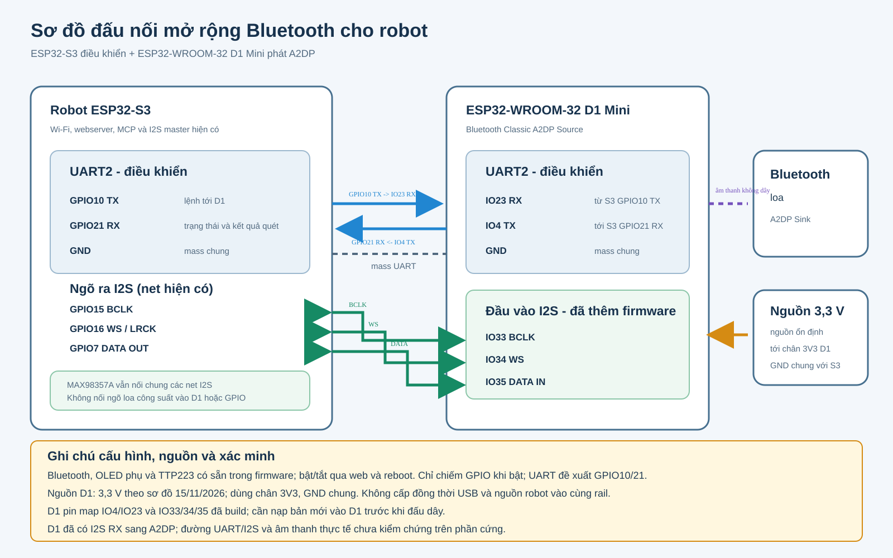

# Mở rộng loa Bluetooth cho KyNangSo Robot

Tài liệu này mô tả phần mở rộng ESP32-WROOM-32 D1 Mini cho board ESP32-S3 `kynangso-robot`, cách điều khiển tập trung qua webserver/MCP của robot và trạng thái xác minh. Sơ đồ logic có thể mở dạng vector tại [bluetooth-robot-integration.svg](bluetooth-robot-integration.svg). Sơ đồ lắp ráp tổng được duy trì tại [circuit_diagram.png](circuit_diagram.png) và [circuit_diagram.svg](circuit_diagram.svg); bản ngày 15/11/2026 là tham chiếu cho thay đổi nguồn D1 sang 3,3 V.

## Kiến trúc

```text
Dashboard / Bluetooth page ─┐
                            ├─ RobotController::BluetoothService ─ UART ─ D1 Mini ─ A2DP ─ loa
MCP tools ──────────────────┘                                      └─ I2S audio từ S3
```

Webserver và MCP dùng chung một `BluetoothService` trên S3. Service gửi lệnh UART và nhận trạng thái/danh sách thiết bị từ D1; D1 thực hiện quét, kết nối, ngắt kết nối và xử lý chuyển loa cũ sang loa mới. UART chỉ truyền điều khiển/trạng thái. D1 vẫn phát AP mở `KyNangSo-Robot BT` làm đường bring-up/bảo trì; thao tác thông thường dùng Wi-Fi/IP hiện có của robot tại `/bluetooth`. Bluetooth chỉ dùng cho cấu hình loa theo yêu cầu; các lệnh phát nhạc không tự quét hoặc hỏi chọn loa. Loa tích hợp luôn nhận luồng âm thanh từ S3; nếu D1 đã kết nối, D1 phát thêm cùng luồng sang loa Bluetooth. Nếu chưa kết nối, loa robot vẫn phát bình thường.

S3 không có Bluetooth Classic A2DP. D1 Mini dùng ESP32-WROOM-32 làm A2DP Source để phát tới loa Bluetooth A2DP Sink. Mỗi lần đổi loa, D1 dừng stream, ngắt loa đang dùng, đợi sự kiện ngắt rồi mới nối đích mới. MCP tìm theo đoạn tên không phân biệt hoa thường và chỉ kết nối khi có đúng một kết quả; trang web chọn theo địa chỉ để xử lý được các loa trùng tên.

## Tùy chọn phần cứng

OLED và touch là phần mở rộng runtime, mặc định tắt trong NVS `robot_ext`. Cấu hình build chính thức của board robot đặt `CONFIG_KYNANGSO_ROBOT_D1_BLUETOOTH_SUPPORT=y` để công tắc Bluetooth khả dụng trên web. Bluetooth vẫn tắt runtime theo mặc định: khi NVS `robot_ext.bluetooth=false`, S3 không cài UART2, không chiếm GPIO10/21, không tạo task/timer Bluetooth và không đăng ký MCP Bluetooth. Để thử D1, bật công tắc trong dashboard rồi khởi động lại robot. Kconfig mặc định chung vẫn là `n`; biến thể build khác không bật cờ này sẽ khóa công tắc và không khởi tạo phần cứng D1. Kconfig vẫn cho phép đổi pin map khi chủ động build hỗ trợ.

## Sơ đồ đấu nối



### UART điều khiển

| ESP32-S3 robot | ESP32 D1 Mini | Hướng / chức năng |
| --- | --- | --- |
| GPIO10 TX | IO23 RX | Lệnh `STATUS`, `AUTO_CONNECT`, `KEEPALIVE`, `SCAN`, `CONNECT <MAC>`, `DISCONNECT` |
| GPIO21 RX | IO4 TX | Frame JSON trạng thái và thiết bị tìm thấy; IO4 cùng dãy pad với IO2 nhưng không phải chân boot-strap |
| GND | GND | Mass chung |

UART chạy 115200 baud, 8N1, mức logic 3,3 V; không cần bộ chuyển mức. Pin map chọn hai dãy pad đối diện trên D1 để đi dây thẳng khi xếp chồng board; GPIO4 được chọn thay IO2 để tránh chân boot-strap. TX/RX phía S3 chỉ được pin-mux khi đã bật Bluetooth trong cấu hình và khởi động lại. Đặt USB-C của hai board cùng hướng; đối chiếu nhãn IO trên đúng board trước khi hàn.

### Âm thanh và nguồn

| ESP32-S3 robot | D1 Mini | Ghi chú |
| --- | --- | --- |
| GPIO15 BCLK (cùng net MAX98357A) | IO33 | I²S BCLK vào D1 |
| GPIO16 WS/LRCK (cùng net MAX98357A) | IO34 | I²S word select vào D1 |
| GPIO7 DOUT (cùng net DIN MAX98357A) | IO35 | I²S data vào D1 |
| GND | GND | Mass chung |
| Rail 3,3 V robot | Đầu vào 3V3 của D1 | Theo sơ đồ ngày 15/11/2026; GND chung |

Sơ đồ `circuit_diagram.png`/`.svg` cập nhật ngày 15/11/2026 chuyển nguồn D1 từ 5 V sang 3,3 V. Sơ đồ Bluetooth phụ này dùng cùng mức nguồn. Nối vào đầu vào **3V3 đã xác định trên D1**, không suy ra pad ghi VCC/5V/VIN là đầu vào 3V3. Phép đo VCC–GND 5 V qua USB-C trước đây chỉ là dữ liệu bring-up cũ, không phải cấu hình nguồn hiện tại. GPIO/UART/I²S vẫn dùng logic 3,3 V và GND chung; đổi rail nguồn không cần sửa giao thức hay webservice Bluetooth. Tránh hai nguồn cùng cấp một rail khi cắm USB để nạp D1. Chưa có phép đo tải/sụt áp của cấu hình nguồn 3,3 V mới trong lượt cập nhật tài liệu này.

D1 firmware có I²S RX slave Philips 24 kHz, slot trái 32-bit, đổi mẫu sang PCM 44,1 kHz stereo cho A2DP; vòng đệm hữu hạn bỏ mẫu mới khi đầy và phát im lặng khi thiếu mẫu. **Firmware S3 và D1 vừa build thành công, gồm cả lưu loa và tự kết nối lại; bản build này chưa được nạp lên mạch. UART/I²S và âm thanh thực tế chưa được kiểm chứng trên dây thật.** Cần nạp firmware tích hợp rồi mới xác nhận phát nhạc/TTS qua Bluetooth. MAX98357A và loa robot vẫn nối như cũ; âm thanh có thể đi song song tới hai nhánh sau khi kiểm chứng mức tín hiệu và độ trễ.

D1 lưu địa chỉ MAC và tên của loa sau khi kết nối A2DP thành công. Khi Bluetooth runtime được bật trên S3, S3 khởi động phiên điều khiển bằng `AUTO_CONNECT` và gửi `KEEPALIVE` mỗi 15 giây. D1 thử kết nối loa đã nhớ; nếu loa đang tắt, ngoài vùng phủ sóng hoặc bận với thiết bị khác, D1 thử lại sau 30 giây. Kết quả quét không tự chọn loa. Quét hoặc ngắt kết nối thủ công tạm dừng tự kết nối; kết nối thành công một loa khác sẽ thay thông tin đã lưu. Nếu S3 mất heartbeat trên 45 giây, D1 dừng tự kết nối và ngắt liên kết. Khi công tắc Bluetooth runtime trên S3 tắt, S3 không khởi tạo UART hay gửi lệnh tới D1.

Khi tự kết nối thành công, S3 phát âm thanh khởi động sẵn có của robot và TFT hiển thị tên loa. Firmware chưa đọc tên loa bằng giọng nói vì tên thiết bị tùy ý và chưa có TTS cục bộ cho chuỗi này.

D1 lấy tín hiệu trực tiếp từ bus I²S loa hiện có của S3. Khi đã kết nối loa Bluetooth, mọi âm thanh mà S3 phát qua bus này (nhạc, TTS và thông báo) sẽ được chuyển tiếp; hiện chưa có chọn nguồn riêng chỉ dành cho nhạc.

### Bố trí dây khi xếp chồng

Trong robot hiện tại, D1 Mini màu xanh nằm phía trên cảm biến touch; ESP32-S3 màu đen nằm bên dưới trong thân robot. Đặt hai cổng USB-C cùng hướng. Theo thứ tự pad liền kề, nối S3 GPIO7→D1 IO35, GPIO15→IO33, GPIO16→IO34 để ba dây I²S chạy song song, không cắt chéo. UART dùng GPIO10→IO23 và GPIO21←IO4 ở hai dãy đối diện; IO4 nằm cùng dãy pad với IO2 nhưng tránh chân boot-strap. Dùng dây ngắn, mass chung và không đưa 5 V vào GPIO.

Pin map D1 trong source vừa được đổi từ IO18/IO19 và IO26/IO25/IO22 sang IO4/IO23 và IO33/IO34/IO35. Bản build trước đó vẫn dùng pin map cũ; cần build và nạp lại D1 trước khi đấu theo sơ đồ này.

## Điều khiển trên robot

Trang `/bluetooth` dùng giao diện responsive với icon SVG nội bộ, thẻ trạng thái kết nối và danh sách loa có chọn thiết bị rõ ràng. Các nhãn, thông báo và lỗi hiển thị bằng tiếng Việt có dấu; tên loa giữ nguyên theo thiết bị. Nút thao tác tự khóa khi mô-đun tắt/ngoại tuyến, đang quét hoặc chuyển loa; kết quả quét không tự chọn loa đầu tiên. Trạng thái tự cập nhật mỗi 2 giây, không gửi request chồng nhau. Thông báo lệnh được hiển thị riêng để không bị lần cập nhật trạng thái tiếp theo ghi đè.

Mở trang web của robot rồi chọn **Loa Bluetooth**, hoặc gọi các endpoint sau qua cùng IP của robot:

- `GET /api/bluetooth/status` hoặc `/api/bluetooth/devices`: trạng thái và kết quả quét gần nhất.
- `POST /api/bluetooth/scan` với `{}`: quét lại; thao tác quét ngắt loa đang kết nối theo chính sách A2DP hiện tại.
- `POST /api/bluetooth/connect` với `{"address":"AA:BB:CC:DD:EE:FF"}`: nối thiết bị đã có trong kết quả quét gần nhất.
- `POST /api/bluetooth/disconnect` với `{}`: ngắt loa.

MCP tools được đăng ký trên cùng controller: `self.robot.bluetooth.status`, `self.robot.bluetooth.scan`, `self.robot.bluetooth.connect` (tham số `name`) và `self.robot.bluetooth.disconnect`. Luồng gợi ý là scan → status → connect theo tên; nếu tên khớp nhiều kết quả, MCP trả lỗi yêu cầu phân biệt thay vì tự chọn.

## Quan sát và chọn loa trên robot

MCP `scan`, `connect`, `disconnect`, thao tác web và nút vật lý dùng chung trạng thái BluetoothService. Khi lệnh được chấp nhận, bảng Bluetooth trên TFT tự mở; kết quả quét xuất hiện dần, ba loa mỗi trang. Tên dài chạy ngang, dòng phụ có đuôi địa chỉ MAC và RSSI để phân biệt thiết bị trùng tên. Icon Bluetooth và thanh tiến trình biểu thị quét/kết nối; dòng trạng thái báo kết quả.

TFT ST7789 hiện không có cảm ứng; thao tác chính dùng **cảm biến TTP223** khi đã bật touch trong phần mở rộng. Trong bảng Bluetooth: **chạm đơn chọn loa tiếp theo (hết danh sách quay về loa đầu), chạm đôi kết nối loa đang chọn; nếu danh sách trống thì chạm đôi quét lại; giữ chạm 1,2 giây đóng bảng và vẫn dừng motor ngay như chức năng an toàn hiện có**. Chạm đơn/chạm đôi được phân biệt bằng cửa sổ 350 ms của driver, nên chạm đôi không làm nhảy lựa chọn trước khi kết nối. Khi đang quét/chuyển loa, chạm đơn/đôi được giữ trong ngữ cảnh Bluetooth nhưng không gửi lệnh chồng; giữ chạm vẫn đóng được bảng.

Nếu có nút vật lý, VOL+ chọn loa trước, VOL− chọn loa tiếp, BOOT kết nối/quét lại, giữ VOL− đóng bảng vẫn là cách thao tác bổ sung. TFT ưu tiên hiện hướng dẫn touch nếu touch đã bật; nếu touch tắt thì hiện hướng dẫn nút. Khi bảng đã đóng hoặc bị giao diện ưu tiên cao che, touch trở về chức năng cũ (biểu cảm, player, hội thoại, báo thức). Có thể tiếp tục yêu cầu kết nối bằng tên qua MCP hoặc chọn địa chỉ trên web. Bảng kết quả tự đóng sau 120 giây không thao tác; kết quả kết nối/ngắt loa hiển thị khoảng 5 giây rồi trả TFT về chế độ hiện hành. Thao tác quá 60 giây báo hết thời gian chờ; đóng bảng không hủy lệnh đang chạy trên D1.

Nếu OLED phụ đã bật và có màn hình, OLED tạm hiển thị icon Bluetooth, chấm tiến trình/dấu thành công/lỗi và dòng chữ chạy tiếng Việt có dấu: đang quét, đang kết nối, tên loa hoặc kết quả. Kết quả giữ 3,5 giây rồi khôi phục chế độ và nội dung đang lưu; không ghi NVS hoặc thay đổi cấu hình OLED. OLED không có hoặc đang tắt thì bỏ qua. Dữ liệu hiển thị được cập nhật tối đa mỗi 500 ms qua application task; callback timer không gọi LVGL hoặc I²C, chỉ có một lần cập nhật đang chờ để tránh đầy hàng đợi. Màn hình khởi động, báo thức, QR và OTA giữ ưu tiên cao hơn bảng Bluetooth.

Phần này đã triển khai trong source; cần nạp firmware và thử thực tế danh sách, nút, thứ tự ưu tiên, nét chữ/icon, mất UART và khôi phục OLED trên robot.

## Trạng thái triển khai và xác minh

- Đã thêm `BluetoothService` dùng UART2 trên S3, endpoint HTTP, trang `/bluetooth`, và bốn MCP tools dùng chung một service.
- D1 firmware nhận lệnh UART, gửi trạng thái và thiết bị quét; chỉ kết nối lại loa đã lưu theo yêu cầu phiên Bluetooth bật trên S3.
- Đã tạo sơ đồ SVG thể hiện UART và các net I²S/nguồn.
- Build thành công firmware S3 và D1 sau thay đổi lưu loa/tự kết nối lại. Chưa nạp bản build này lên hai mạch hoặc kiểm thử UART trên dây thật.
- Chưa xác minh pad GPIO10/21 vật lý, khả năng cấp nguồn robot vào VCC, I²S RX D1, phát âm thanh thực tế, độ trễ/đồng bộ hoặc chuyển loa thứ hai trên bản tích hợp.

## Ghi chú log

Không đấu D1 Mini không gây ra cảnh báo `AFE(FEED) is full` hoặc lỗi `WSS handshake`. AFE cảnh báo khi task `fetch` xử lý chậm hơn luồng microphone. Ưu tiên task AFE của variant đã được trả về mức gốc 3; cảnh báo AFE cần được chẩn đoán riêng theo log audio và tải CPU khi robot đang nghe, không phụ thuộc D1 Bluetooth. Firmware không tắt cảnh báo này.

`WebSocket handshake failed` cùng `protocol_error` nghĩa là kết nối WSS bị đóng hoặc bị từ chối trước khi nâng cấp thành WebSocket. Bridge giờ tăng thời gian thử lại 5, 10, 20 rồi tối đa 30 giây để tránh lặp TLS liên tục. Lỗi này cần đối chiếu URI, credential `device_id`/token đã provision và log của backend/reverse proxy; nó độc lập với mạch Bluetooth.

Dự án firmware độc lập của D1 ở [tools/esp32-d1-bluetooth](../../../../tools/esp32-d1-bluetooth/readme.md). Hướng dẫn board robot ở [readme KyNangSo Robot](../readme.md).
