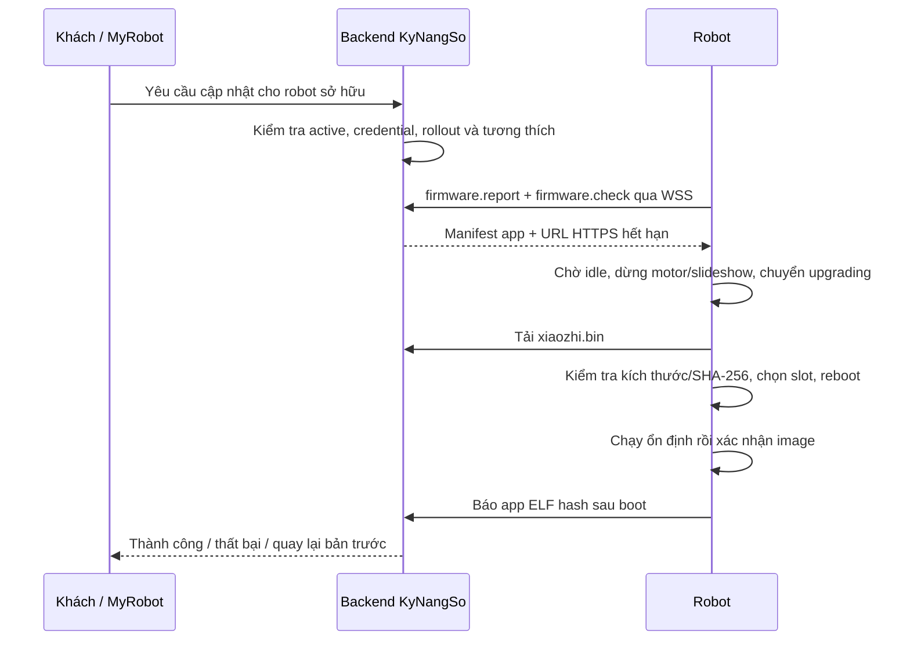

# OTA firmware KyNangSo

Trạng thái hiện thực và kiểm thử: [PLAN.md](PLAN.md).

OTA ứng dụng dùng hai slot 4032 KiB trong `partitions/16m.csv`. Không đổi bootloader, partition hay assets qua luồng này. Các thay đổi đó yêu cầu nạp USB. Firmware nền tảng cần được nạp qua USB trước khi robot có thể nhận các lần cập nhật tiếp theo qua mạng.

## Module và luồng gọi

- `features/firmware/robot_ota.*`: worker kiểm tra/báo phiên bản qua WSS và điều phối OTA khi robot idle.
- `display/tft/kynangso_robot_display.*`: panel cập nhật, font tiếng Việt và thanh tiến độ phủ trên giao diện đang có.
- `main/ota.*`: bộ tải chung của cộng đồng, bổ sung SHA-256 và kiểm tra kích thước; không phụ thuộc board cụ thể.
- `main/application.*`: vòng đời cập nhật/audio và reboot; chỉ thêm tham số kiểm tra tùy chọn để các caller hiện có vẫn dùng được.
- `Board::AllowAutomaticFirmwareUpgrade()`: mặc định cho phép; KyNangSo trả `false` để Tenclass tiếp tục cung cấp activation/cấu hình hội thoại nhưng không tự chọn firmware thay cho kênh phát hành KyNangSo.

## Tài nguyên và trạng thái

Worker định kỳ dùng stack PSRAM 6144 byte; mỗi vòng cách 60–75 giây, kiểm tra lần đầu sau khoảng 45 giây. Không tải tự động chỉ vì có release mới: cần yêu cầu của khách còn hiệu lực. Worker xác nhận boot/đọc flash dùng stack nội bộ riêng 4096 byte; chỉ lúc cập nhật mới tạo task tải/ghi flash với stack nội bộ 8192 byte. Không ghi flash từ task có stack PSRAM và không chạy vòng tải trong main event loop hay audio task.

Quyết định idle và chuyển trạng thái đi qua `Application::Schedule()`. Robot đang nghe/nói/phát media tiếp tục hoạt động; yêu cầu OTA chờ vòng kiểm tra tiếp theo. Trước OTA, controller dừng motor và slideshow. Nếu tải/kiểm tra thất bại, không chọn slot mới, phục hồi audio và quay về idle; người dùng chủ động thử lại.

Firmware báo version, app ELF hash, hash partition-table và hash blob assets đang dùng (12 byte header cộng payload theo `stored_len`). Hash assets được tính theo từng khối 4 KiB, bỏ qua vùng flash chưa sử dụng. Backend so khớp model/partition/assets; SHA-256 của toàn file ứng dụng được kiểm tra khi tải xong, trước khi chọn boot partition. `release_id` định danh bản build; hai build cùng version nhưng ELF hash khác vẫn được phân biệt.

`CONFIG_KYNANGSO_MANAGED_OTA=y` bật client; board đặt `CONFIG_OTA_VERIFY_DELAY_SECONDS=30` và bật `CONFIG_BOOTLOADER_APP_ROLLBACK_ENABLE`. Worker local xác nhận image sau khoảng 45 giây hoạt động; không bắt buộc server/Internet phải hoạt động để xác nhận. Reset/crash trước khi image được xác nhận sẽ cho bootloader cơ hội rollback. Lỗi nghiệp vụ xảy ra sau khi image đã xác nhận không tự kích hoạt rollback; có thể phát hành lại bản ứng dụng trước nếu vẫn tương thích dữ liệu.

## Build và xác nhận

Chạy `idf-init` nếu cần, rồi `kynangso-build-firmware.bat`. Thêm source mới vào `board_sources.cmake`. Kho release và cách phát hành được mô tả tại `xiaozhi-kynangso-services/docs/features/firmware-ota/README.md`.

Kiểm thử thực tế cần có hai release: nạp bản nền tảng qua USB, publish bản thứ hai đến robot thử nghiệm, kiểm tra tiến độ, reboot, version/hash mới, giữ Wi-Fi/NVS và hoạt động hội thoại. Thử mất mạng khi tải và reset trước xác nhận trên robot thử nghiệm; build/kiểm thử backend không thay thế các bước này. Hash assets không khớp cần kiểm tra đúng tài nguyên của release và nạp lại qua USB trước khi dùng OTA ứng dụng.
