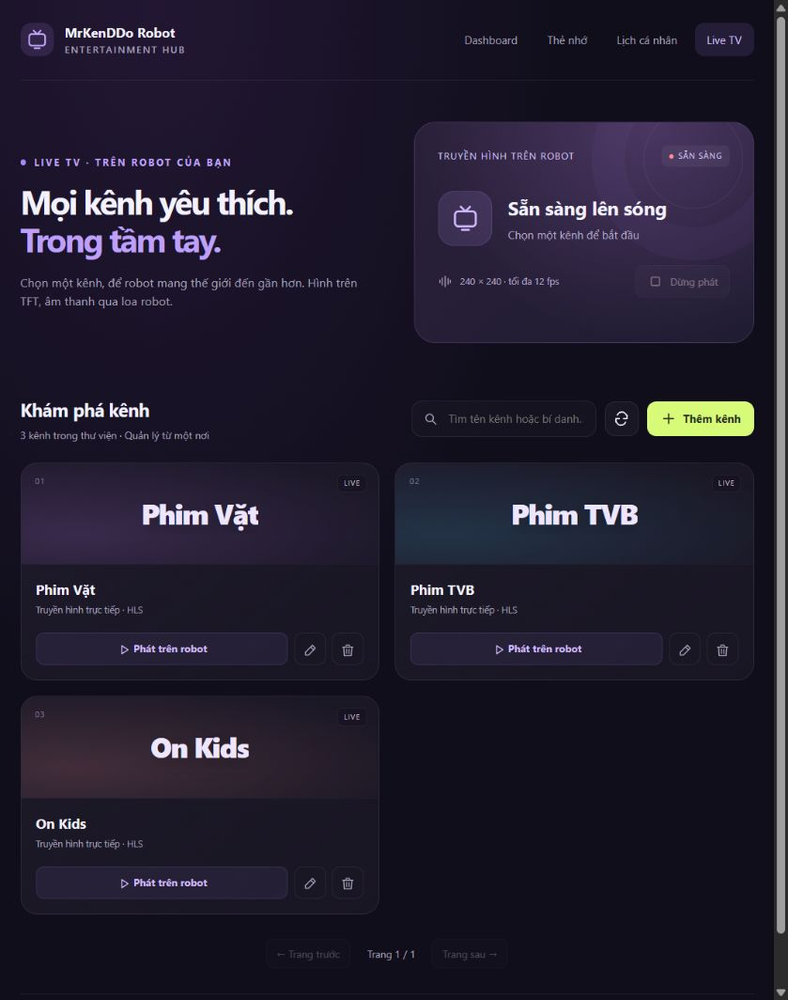
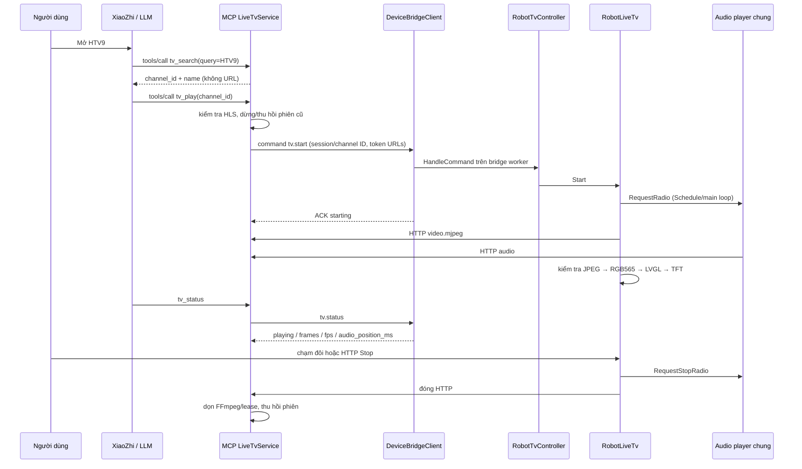

# Live TV trên KyNangSo Robot

Kế hoạch đã chốt và checklist tiếp tục công việc: [PLAN.md](PLAN.md).
Server companion: `xiaozhi-kynangso-services/docs/features/live-tv/README.md`.

## Module và quyền sở hữu

- `robot_live_tv.*` / `RobotLiveTv`: worker video, frame giới hạn, PSRAM,
  trạng thái thật và vòng đời start/stop. Audio dùng `Application::RequestRadio`
  và `ContinuousStreamPlayer`/`NotifyPlayer`, không thêm audio pipeline riêng.
- `robot_tv_controller.*`: hợp đồng sản phẩm cho `tv.start/stop/status`, nối
  yêu cầu catalog từ web tới `Application::RequestService`.
- `tv_web_server.*`: trang `/tv`, API HTTP bất đồng bộ, một job tại một thời
  điểm; worker stack 8 KiB trong PSRAM. Status/Stop tại chỗ trả nhanh ngay cả
  khi catalog đang chờ server. Stop không phụ thuộc VPS để dừng loa/video.
- `tv_web_ui.h`: HTML/CSS/JS giải trí, responsive, không tải video về browser;
  card kênh, search, editor tên/URL/bí danh, check nguồn, phát/dừng và lỗi thật.
- `DeviceBridgeClient`: chỉ thêm RPC chung request/response trên TLS WSS;
  không biết catalog hay tên kênh. `Application` cung cấp facade RPC và đọc
  trạng thái stream chung; TV policy và GPIO vẫn thuộc custom board.

## Đăng ký MCP, tìm kênh và phát

Bốn tool `tv_search`, `tv_play`, `tv_stop`, `tv_status` được đăng ký bằng
`@mcp.tool` tại MCP service `webserver/app.py`. `XiaoZhiMcpEndpoint` chuyển
JSON-RPC từ MCP Access Point vào app. Firmware không đăng ký lại catalog TV
trong `robot_mcp_tools.cc`; nó chỉ thực thi lệnh có ID do service gửi.

Khởi tạo board tạo player/controller rồi truyền controller cho WebServer.
`HandleDeviceBridgeCommand` chuyển namespace `tv.*` cho controller. JSON/board
I/O/ACK chạy trên worker bridge 12 KiB, không chạy trên task `ssl_receive`.
Thay đổi trạng thái ứng dụng/audio vẫn đi qua `Application::Schedule` và state
machine. Trạng thái audio nội bộ dùng `radio` vì là live stream; TV có trạng
thái/metadata riêng để UI và MCP không hiển thị nhầm radio hoặc idle.

## Web API và chiều RPC ngược

Trang `/tv` gọi cùng-origin, không có credential trong JavaScript:

| Endpoint | Vai trò |
| --- | --- |
| `GET /api/tv/status` | Status tại chỗ, server_connected, tên/ID, fps, audio progress |
| `GET /api/tv/channels?query=…&page=0` | Catalog summary 10 kênh/trang |
| `GET /api/tv/channel?id=…` | Detail để sửa tên/URL/bí danh/version |
| `POST /api/tv/channel` | `{channel:{name,url,aliases,enabled,order,id?,version?}}` |
| `POST /api/tv/channel/delete` | `{id,version}`; dừng phiên nếu kênh đang phát |
| `POST /api/tv/check` | `{url}`; kiểm tra playlist từ VPS, không mở player |
| `POST /api/tv/play` | `{id}`; kiểm tra và mở/chuyển phiên |
| `POST /api/tv/stop` | Dừng tại chỗ, không chờ catalog/bridge |

Worker HTTP → `RequestService` → WSS `request {id,payload}`. Bridge worker chỉ
gửi/ghép response, không chặn đợi chính nó. Server dispatch riêng nên có thể
gửi lệnh ngược `tv.start` và tiếp tục nhận ACK trước khi trả RPC response.
Một request firmware chờ tối đa 20 giây; request 4 KiB, response tối đa 8 KiB,
receive frame 12 KiB. Timeout/disconnect trả lỗi; không tự replay thao tác sửa.
UI tải lại trước khi thử lại một thao tác chưa rõ kết quả. Stop/Status không
phải xếp hàng sau một thao tác catalog. Phiên stream và catalog không ghi NVS.

Response WSS chứa chuỗi `result_json`; firmware chuyển nguyên JSON sang HTTP,
không tạo cây cJSON cho cả danh sách kênh trong SRAM nội bộ. Lỗi nghiệp vụ có
`ok:false,error`; UI kiểm tra cả trường này và HTTP status. Khóa `version` là
điều kiện cập nhật/xóa, không dùng dữ liệu cũ để ghi đè thay đổi của tab khác.

## Hiển thị, tài nguyên và khôi phục

Tên kênh là badge góc trên bên phải, nền bán trong suốt, rút gọn tên dài để
tránh redraw chữ chạy. Cảnh báo đồng hồ/báo thức và QR có ưu tiên; màn đồng hồ
bình thường không che TV. Dừng quay về mode hiện tại theo bộ điều phối UI.
Nhãn kênh dùng font Unicode của theme, kể cả sau khi assets thay font; top layer
không tự kế thừa font này. TV bị từ chối khi boot hoặc chuông báo đang mở.
Mở TV dừng slideshow SD; mở ảnh dừng cả TV/tiếng. Nhạc/radio mới nhận quyền
audio sẽ dừng riêng video TV để không hủy âm thanh vừa được yêu cầu.

`starting` chưa xác nhận có hình/tiếng. `playing` cần frame hợp lệ và audio
position đã tiến. `reconnecting` có backoff, tối đa 5 lần thất bại liên tiếp;
nguồn video không phục hồi sẽ dừng cả audio. Frame được xác thực baseline JPEG
và kích thước tối đa 240×240 **trước** khi gọi decoder, payload tối đa 128 KiB.

Worker video stack 8 KiB và frame trong PSRAM; tạo/xóa bằng cặp WithCaps.
HTTP worker chỉ có khi người dùng thao tác, không thêm kết nối TLS. N16R8 giữ
Wi-Fi RX 6/24, BA 6, TCP receive window 17.280 byte, Wi-Fi/LwIP ưu tiên PSRAM.
Board cấu hình 16 socket tổng và HTTP server giữ tối đa 4 kết nối, dành chỗ cho
WSS/MQTT/audio/video. Giới hạn này áp dụng chung các trang web của robot; không
tăng kết nối trình duyệt vô hạn. Thao tác catalog chỉ có một worker tạm thời.
`Video stats` khoảng 5 giây: received/submitted/refreshed, fps, thời gian đọc,
decode/present, gap, internal heap/largest block, RSSI và stack headroom.
Refresh LVGL không phải phép đo quang học TFT. Không sync console log ra web
khi chưa bật trình xem log. TV không tự phát lúc boot, không kích hoạt motor.

Hai track hiện chưa có PTS chung; kiểm tra A/V trên robot, không suy ra lip-sync
từ số frame. Chi tiết kiểm chứng, build/flash và các giới hạn nằm trong PLAN.md.
