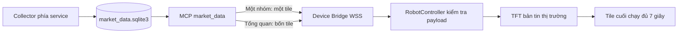

# Bản tin giá thị trường trên TFT

> [!IMPORTANT]
> Giá hiển thị là dữ liệu tham khảo đã được crawler ghi vào SQLite. Robot không truy cập trực tiếp website nguồn và không ước tính phần dữ liệu còn thiếu. Quản trị viên cần bật collector và xác nhận quyền sử dụng nguồn trước khi có báo giá.

## Luồng dữ liệu

MCP đọc snapshot crawler rồi trả về báo giá có cấu trúc, gồm nhóm, mã/tên hàng, vùng, loại giá, số tiền, tiền tệ, đơn vị, nguồn, thời điểm hiệu lực/quan sát và cờ `stale`. Câu hỏi không khởi chạy crawler hoặc gọi API nguồn.

## Cách chọn nhóm qua MCP

MCP tool `market_data(category, query, device_id, display_on_robot)` chấp nhận category tiếng Việt hoặc tiếng Anh:

| Ý định | `category` | Tile TFT |
| --- | --- | --- |
| Giá cà phê, hồ tiêu hoặc nông sản | `agriculture` / `nông sản` | Giá nông sản |
| Giá vàng | `gold` / `vàng` | Giá vàng |
| Giá xăng RON95 | `fuel` / `xăng dầu` | Giá xăng dầu |
| Tỷ giá USD, EUR | `fx` / `tỷ giá` / `ngoại tệ` | Giá ngoại tệ |
| Hỏi chung “giá cả thị trường thế nào?” | `all` | Cả bốn tile theo thứ tự bảng trên |

Một truy vấn một nhóm chỉ gửi một tile. Hỏi tổng quan gửi đủ bốn nhóm theo thứ tự **nông sản → vàng → xăng dầu → ngoại tệ**. Nếu một nhóm chưa có báo giá đã crawl, tile vẫn giữ tiêu đề nhóm và ghi “Chưa có báo giá đã crawl”; robot không điền giá thay thế.

MCP trả về `tiles[]` với `category`, `title`, `source`, `effective_at`, `observed_at`, `available`, `stale` và các dòng `rows[]` (`label`, `value`). Khi trả lời bằng giọng nói, assistant chỉ đọc số liệu trong kết quả, nêu nguồn/thời điểm phù hợp và báo rõ dữ liệu cũ hoặc thiếu. `device_id` được dùng khi có nhiều robot; nếu không chọn được thiết bị, MCP vẫn trả dữ liệu nhưng `display.status` cho biết TFT chưa nhận bản tin.

## Hợp đồng Device Bridge

MCP gửi một lệnh WSS `display.market_bulletin` chứa từ 1 đến 4 tile. Payload được giới hạn dưới 3.500 byte để nằm trong giới hạn 4.096 byte của Device Bridge; nếu cần, backend rút gọn cân bằng số dòng chỉ dành cho TFT. Robot xác thực nhóm, số tile, số dòng và độ dài chuỗi trước khi xếp payload vào hàng đợi ứng dụng. Firmware dùng category để chọn tiêu đề và màu cố định; không nhận HTML, ảnh hoặc nội dung tùy ý để vẽ.

- Mỗi tile hiển thị **7 giây khi thực sự ở foreground**. Bản tin tạm phủ mặt robot và màn hình chính thông thường. Nếu báo thức, phát media/TV hoặc một màn hệ thống ưu tiên cao đang chiếm TFT, bộ đếm tile tạm dừng rồi tiếp tục khi TFT rảnh.
- Danh sách dài tự cuộn dọc trong tile; cuộn lặp lại đến khi hết 7 giây hiển thị.
- Chỉ sau khi tile cuối chạy đủ thời gian, phiên mới kết thúc và TFT quay lại nội dung trước đó.
- Màn hình chỉ tạo một view LVGL tái sử dụng; tối đa 4 tile, 8 dòng mỗi tile. Không tải ảnh, không ghi microSD/NVS, không polling và không thêm xử lý lên audio task.
- Hiện là trải nghiệm TFT; OLED phụ không nhận bảng giá.

## Vận hành và giới hạn dữ liệu

- Cấu hình nguồn, quyền sử dụng, lịch crawl và kiểm tra giá thuộc [dịch vụ dữ liệu thị trường phía backend](../../../../../../../xiaozhi-kynangso-services/docs/features/market-data/README.md) trong repo service.
- Nếu MCP báo nhóm chưa có dữ liệu, kiểm tra trạng thái dịch vụ, quyền nguồn, collector và lần crawl gần nhất trên Admin board.
- Giá cũ được đánh dấu trên tile. Thời điểm trên TFT là giờ Việt Nam, rút gọn để phù hợp màn hình; dữ liệu MCP giữ timestamp đầy đủ.
- Giá chỉ mang tính tham khảo, không phải báo giá giao dịch hoặc khuyến nghị đầu tư. Cổ phiếu không thuộc bốn nhóm này.

## Ví dụ câu hỏi

| Tiếng Việt | English |
| --- | --- |
| “Giá vàng hôm nay thế nào?” | “What is the latest gold price?” |
| “Tỷ giá USD mới nhất là bao nhiêu?” | “What is the latest USD exchange rate?” |
| “Giá cả thị trường hiện ra sao?” | “Give me a market overview.” |
