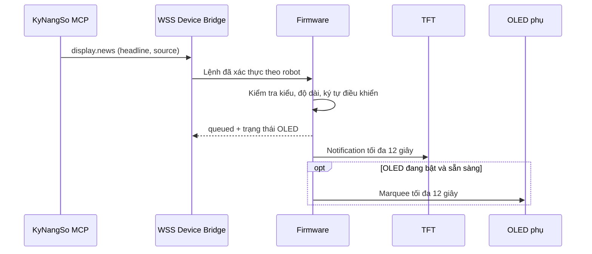

# 📰 Hiển thị tin tức trên robot KyNangSo


> [!TIP]
> Robot chỉ nhận một tiêu đề ngắn từ server khi người dùng hỏi tin. Robot không tự kết nối báo, tải RSS hay chạy vòng polling.

> [!NOTE]
> Kết quả thị trường dùng lại `display.news` hiện có. Firmware không gọi API giá, không tự làm mới dữ liệu và không cần thêm polling hoặc task nền. Nếu robot không hiện tóm tắt, hãy kiểm tra firmware trên board có hỗ trợ lệnh `display.news` hay chưa.

## 🔄 Luồng hiển thị



Server giữ RSS, cache, lọc nguồn và tạo kết quả MCP. Firmware chỉ xử lý hai chuỗi `headline` và `source`, rồi dùng các API hiển thị sẵn có.

## 📈 Hiển thị kết quả thị trường

Giá, tỷ giá, lãi suất hoặc cổ phiếu chỉ xuất hiện khi người dùng hỏi và backend gửi một tóm tắt cùng nguồn. Firmware xử lý payload giống tin tức; không cần biết API provider, credential, đơn vị cache hoặc cách quy đổi giá. Nội dung đã được server rút gọn trước khi gửi, còn firmware tiếp tục chặn chuỗi vượt giới hạn byte như hợp đồng ở trên.

```json
{
  "type": "display.news",
  "headline": "<tóm tắt ngắn từ dữ liệu có nguồn>",
  "source": "<nhóm dữ liệu> · <nhà cung cấp>"
}
```

TFT hiển thị notification ngắn; OLED phụ chạy marquee nếu phần cứng/driver đã bật. Việc gửi màn hình là tùy chọn: robot offline hoặc đang bận không làm hỏng kết quả MCP trả về cho người dùng.

## 📡 Hợp đồng WSS

```json
{
  "type": "display.news",
  "headline": "Tiêu đề tin ngắn",
  "source": "Tên nguồn báo"
}
```

| Trường | Giới hạn | Kiểm tra |
| --- | ---: | --- |
| `headline` | 1–160 byte UTF-8 | Không nhận ký tự điều khiển |
| `source` | 1–48 byte UTF-8 | Không nhận ký tự điều khiển |

Lệnh chỉ được chấp nhận qua Device Bridge đã xác thực. Server giới hạn mỗi robot tối đa một lần hiển thị trong 12 giây; robot không cần tự duy trì bộ đếm hoặc state mới.

## 🖥️ Hành vi màn hình

| Màn hình | Hành vi |
| --- | --- |
| **TFT** | Dùng notification sẵn có, hiển thị tiêu đề và nguồn tối đa 12 giây. |
| **OLED phụ** | Nếu OLED đã bật và driver sẵn sàng, hiển thị cùng nội dung dạng marquee tối đa 12 giây. |
| **Không có OLED** | Robot vẫn nhận lệnh và chỉ cập nhật TFT. |
| **Hết thời gian** | Cơ chế notification hiện tại đưa màn hình về nội dung trước đó. |

> [!IMPORTANT]
> Việc gửi lệnh chỉ xác nhận firmware đã xếp cập nhật UI. Cần kiểm tra trên robot thật để xác nhận cách notification tương tác với màn hình đang hoạt động.

## ⚡ Giới hạn tài nguyên

- ✅ Không thêm task, timer, polling hay kết nối mạng mới trên robot.
- ✅ Không ghi NVS, microSD, flash hoặc lưu nội dung tin.
- ✅ Dùng `Application::Schedule()` để cập nhật UI ngoài luồng nhận lệnh WSS.
- ✅ Chỉ truyền tiêu đề và tên nguồn; không truyền toàn bài, ảnh hoặc nội dung dài.
- ✅ OLED là phần cứng tùy chọn; kiểm tra trạng thái sẵn sàng trước khi dùng.

## 🔐 An toàn và xác minh

1. WSS kiểm tra credential và định tuyến lệnh theo đúng robot.
2. Firmware kiểm tra kiểu dữ liệu, giới hạn byte và ký tự điều khiển trước khi hiển thị.
3. Nguồn RSS và URL bài gốc được kiểm soát ở server; robot không nhận URL để tự tải.

Build firmware chỉ xác nhận biên dịch thành công, chưa xác nhận hành vi màn hình trên thiết bị. Khi kiểm tra phần cứng, xác minh TFT, OLED tùy chọn và các trạng thái đang phát nhạc/TV.

📚 **Tài liệu server:** `docs/features/news/README.md` trong repo `xiaozhi-kynangso-services` mô tả MCP, RSS, quyền nguồn, cache và giới hạn server.
