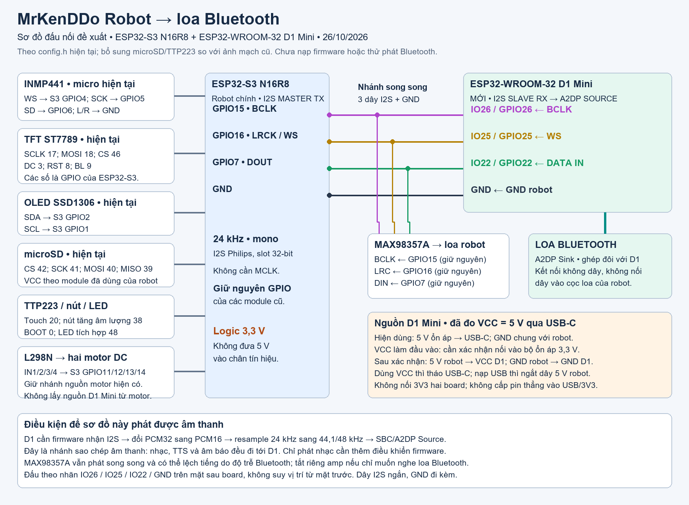

# Mở rộng robot để phát ra loa Bluetooth

Thiết kế đề xuất ngày 26/10/2026, đối chiếu `../config.h`, `../mrkenddo_robot.cc`, `../../../audio/codecs/no_audio_codec.cc` và ảnh D1 Mini do chủ robot cung cấp. Chủ robot đã đo VCC = 5 V khi cấp nguồn D1 Mini qua USB-C. Đã nạp firmware thử A2DP độc lập lên D1 Mini; firmware nhận I2S từ robot chưa được triển khai. Giữ nguyên `circuit_diagram.png/svg` gốc; bản gốc có một số ngoại vi khác cấu hình hiện tại.



[Bản vector SVG](bluetooth-speaker-wiring.svg)

## Dây bổ sung

| Điểm lấy trên robot ESP32-S3 | Điểm đến D1 Mini | Vai trò |
| --- | --- | --- |
| GPIO15, cùng net BCLK của MAX98357A | IO26 (GPIO26) | Clock I2S vào |
| GPIO16, cùng net LRC của MAX98357A | IO25 (GPIO25) | WS/LRCK vào |
| GPIO7, cùng net DIN của MAX98357A | IO22 (GPIO22) | Dữ liệu I2S vào |
| GND | GND | Mass chung |
| Nhánh nguồn 5 V ổn áp đủ tải | USB-C D1 Mini | Nguồn, dùng cáp cấp điện phù hợp |
| Nhánh nguồn 5 V ổn áp đủ tải | VCC D1 Mini | Phương án thay USB-C, chỉ đấu sau khi xác nhận VCC nối vào đầu vào bộ ổn áp 3,3 V |

Các GPIO phía D1 là lựa chọn cho firmware mới, không phải chức năng mặc định khi cắm board. Đọc nhãn IO trên mặt sau; mặt trước và mặt sau bị đảo vị trí khi lật board. Không dùng nhầm IO25/26 thành số thứ tự lỗ hàn. Không dùng các chân flash CLK/SD0/SD1/SD2/SD3/CMD.

S3 là I2S master duy nhất. D1 là slave nhận; MAX98357A vẫn là thiết bị nhận trên cùng bus. Không cấu hình D1 phát BCLK/WS lên bus này. Logic 3,3 V, không cần chuyển mức hay MCLK. Bắt đầu bằng dây ngắn khoảng 10–15 cm, đi GND sát dây tín hiệu và tránh dây motor. Tắt nguồn trước khi đấu; cấp nguồn cả hai board khi thử để tránh dòng đi qua chân tín hiệu vào board mất nguồn.

**Kết quả đo do chủ robot cung cấp:** khi cấp nguồn qua cổng USB-C dùng chung để nạp firmware, điện áp giữa VCC và GND của D1 Mini là 5 V. Kết quả này xác nhận mức điện áp trên VCC trong điều kiện đó; chưa xác nhận VCC có thể dùng làm đầu vào nguồn.

**Phương án cấp nguồn qua chân pin:** sau khi xác nhận bằng sơ đồ hoặc đường mạch rằng VCC nối vào đầu vào bộ ổn áp 3,3 V, đấu **5 V ổn áp robot → VCC D1 Mini**, **GND robot → GND D1 Mini**. Khi dùng nguồn robot qua VCC, tháo USB-C; khi nạp firmware qua USB-C, ngắt dây 5 V từ robot. Trước khi xác nhận đường mạch, tiếp tục cấp nguồn qua USB-C.

Không nối hai đường 3V3, không cấp pin thẳng vào USB-C/3V3, không ghép nguồn USB máy tính với nguồn ngoài. Nhánh nguồn mới phải lấy từ đầu ra 5 V ổn áp đã đo, không lấy từ đầu ra motor hoặc mặc định xem rail pin trong ảnh cũ là 5 V. Kiểm tra sụt áp khi hai motor chạy và Bluetooth đang phát.

## Firmware và giới hạn

Trước khi đấu nối, dùng [project ESP32 D1 Bluetooth](../../../../tools/esp32-d1-bluetooth/readme.md)
để mở trang local tại `http://192.168.4.1/`, quét/chọn loa và phát âm thử qua Bluetooth
chỉ với cáp USB-C. Image hiện tại phát AP mở `MrKenDDo Robot Bluetooth`, không cần mật khẩu.
Trang cấu hình có thể ngắt loa hiện tại rồi chuyển sang loa được chọn. Sơ đồ PNG/SVG
mô tả đường audio I2S; firmware D1 hiện tại chưa nhận audio I2S từ robot.

- ESP32-WROOM-32 chạy **A2DP Source** để gửi âm thanh tới loa **A2DP Sink**. ESP32-S3 của robot không hỗ trợ Bluetooth Classic A2DP trực tiếp.
- Đầu vào hiện tại: I2S Philips, 24 kHz, slot trái, slot 32-bit. Firmware D1 cần lấy đúng mẫu, đổi PCM32 sang PCM16, chuyển mono thành hai kênh tương ứng và resample sang tần số A2DP được thương lượng, thường 44,1 hoặc 48 kHz; tiếp đó mã hóa SBC và truyền A2DP. Không đọc luồng hiện tại như PCM16/44,1 kHz.
- Cần bộ đệm giới hạn, xử lý thiếu mẫu và hiệu chỉnh chênh lệch tốc độ clock I2S/Bluetooth khi chạy lâu. Thử pairing, reconnect và phát liên tục trước khi lắp cố định.
- Đây là bản sao đường ra loa: nhạc, TTS, âm báo đều tới D1; âm lượng robot cũng tác động lên dữ liệu này. Chỉ phát nhạc cần thêm thông tin điều khiển từ S3 tới D1 và logic chọn nguồn; sơ đồ tối thiểu này chưa có đường điều khiển đó.
- Muốn chỉ nghe Bluetooth thì tắt riêng MAX98357A bằng cơ chế shutdown phù hợp module, hoặc tháo loa khi đã tắt nguồn. Không đặt volume robot về 0 vì sẽ làm mất cả tín hiệu gửi D1. Không nối cọc SPK+/SPK− của amp vào GPIO hay GND.
- Loa tại robot và loa Bluetooth có độ trễ khác nhau; không kỳ vọng đồng bộ khi phát song song. Nhánh này vẫn là mono, không khôi phục stereo đã mất trong pipeline robot.

## Điều khiển tập trung qua robot

D1 là phần cứng riêng để cung cấp Bluetooth Classic/A2DP, nhưng giao diện người dùng nên thống nhất ở robot. Kiến trúc đích:

```text
Webserver robot ─┐
                 ├─ RobotController/BluetoothService trên S3 ─ UART ─ D1 ─ Bluetooth A2DP ─ loa
MCP robot ───────┘                                         
Audio I2S của S3 ────────────────────────────────────────────> D1
```

Webserver và MCP gọi cùng một `BluetoothService`; service quản lý lệnh, trạng thái và timeout, rồi trao đổi với D1 qua UART. D1 thực hiện scan/kết nối/ngắt A2DP và trả danh sách loa/trạng thái. Lệnh kết nối theo chuỗi tên cần phân giải từ kết quả scan: chỉ tự kết nối nếu có đúng một kết quả; nếu tên trùng, trả danh sách để người dùng chọn. Khi đổi loa đang phát, D1 dừng stream, ngắt loa cũ, đợi callback ngắt rồi mới kết nối loa đích.

API web dự kiến: `GET /api/bluetooth/status`, `POST /api/bluetooth/scan`, `GET /api/bluetooth/devices`, `POST /api/bluetooth/connect`, `POST /api/bluetooth/disconnect`. MCP dự kiến có `self.robot.bluetooth.scan`, `.connect`, `.disconnect`, `.status`. Webserver và MCP không được tự điều khiển UART hoặc giữ state riêng.

UART dùng hai net 3,3 V và GND chung, độc lập với bus I2S. Chân ứng viên chưa đấu: **robot S3 GPIO10 TX → D1 IO19 RX**, **robot S3 GPIO21 RX ← D1 IO18 TX**, **GND ↔ GND**. GPIO10/21 không nằm trong pin map hiện tại; vẫn phải xác nhận pad trên đúng board và kiểm tra dây thực tế trước khi hàn. I2S vẫn dùng các net ở bảng trên. Chế độ người dùng cuối sẽ truy cập robot qua Wi-Fi/IP hiện có; AP của D1 chỉ nên giữ làm chế độ bring-up/bảo trì. Các service UART, MCP, route/web UI và audio I2S vào D1 **chưa được triển khai**.

## Cơ sở đối chiếu

- [Espressif: khả năng Bluetooth của từng chip](https://docs.espressif.com/projects/esp-idf/en/stable/esp32s3/api-guides/bt-architecture/overview.html).
- [Espressif: I2S master/slave và cấu hình slot](https://docs.espressif.com/projects/esp-idf/en/latest/esp32/api-reference/peripherals/i2s.html).
- [Espressif: A2DP API và ví dụ Source](https://docs.espressif.com/projects/esp-idf/en/stable/esp32/api-reference/bluetooth/esp_a2dp.html).

Đã đối chiếu GPIO với source hiện tại và kiểm tra bản render. Chủ robot xác nhận VCC = 5 V khi cấp nguồn qua USB-C; cũng đã truy cập trang D1, quét và kết nối `Tronsmart Element Groove` thành công ở lần chạy trước. Build mới được nạp riêng vào app ở COM13; esptool xác minh hash. Boot log xác nhận AP mở và A2DP sẵn sàng. Bản mới xử lý quét lại bằng cách ngắt kết nối hiện tại trước, nhưng chưa thử trực tiếp chuyển loa thứ hai qua web UI. Chưa xác nhận đường cấp nguồn robot vào VCC, sụt áp khi chạy tải hoặc I2S/UART thực tế. Kiến trúc điều khiển tập trung ở trên mới là mục tiêu, chưa phải trạng thái firmware hiện tại.
