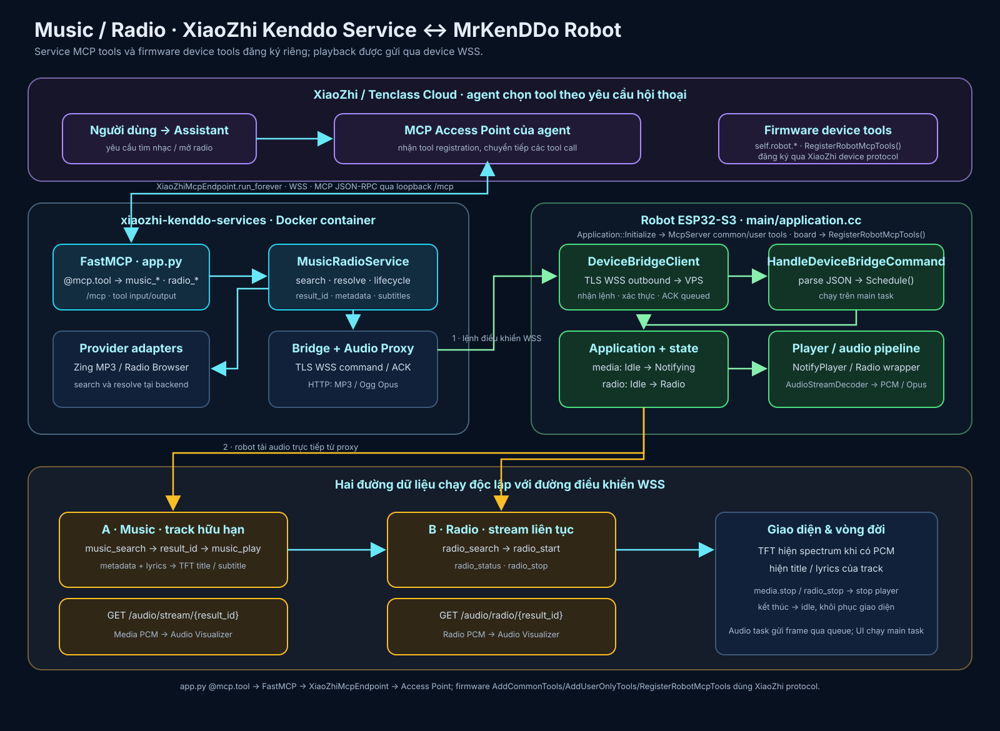

# MrKenDDo Robot

Board ESP32-S3 cho XiaoZhi với màn hình TFT ST7789, OLED SSD1306 phụ hiển thị đồng hồ/chữ chạy/trạng thái, micro và loa I2S simplex, nút bấm, TTP223, microSD, LED và hai motor DC qua hai cầu H của L298N. Build chỉ chọn một board factory qua `DECLARE_BOARD(MrkenDDoRobot)`.

## Phần cứng

| Chức năng | GPIO / cấu hình |
| --- | --- |
| Micro I2S WS/SCK/DIN | 4 / 5 / 6; INMP441 L/R nối GND, slot trái |
| Loa I2S DOUT/BCLK/LRCK | 7 / 15 / 16 |
| LED / BOOT / tăng âm lượng | 48 / 0 / 38; nút giảm âm lượng GPIO39 đã bỏ theo wiring mới |
| microSD CS/SCK/MOSI/MISO | 42 / 41 / 40 / 39; SPI2 riêng, 10 MHz, VCC 3,3 V / GND theo đấu nối hiện tại |
| L298N IN1/IN2 (motor A) | 11 / 12 |
| L298N IN3/IN4 (motor B) | 13 / 14 |
| OLED SDA/SCL | 2 / 1; I2C_NUM_1, địa chỉ mặc định 0x3C |
| OLED / TFT | SSD1306 128×32 / ST7789 240×240 |
| TFT CS/DC/RST/MOSI/SCLK/BL | 46 / 3 / 8 / 18 / 17 / 9 |
| TTP223 I/O / VCC / GND | GPIO20 / 3,3 V / GND; ngõ ra mức cao khi chạm, mức thấp khi thả |

Xem [`docs/circuit_diagram.png`](docs/circuit_diagram.png) hoặc tại https://app.cirkitdesigner.com/project/68109f8c-2d1c-428a-bdca-f183fb424fa7 Firmware giả định motor A ở bên trái, motor B ở bên phải; sơ đồ mạch chỉ cho biết cặp dây, không xác nhận vị trí thực tế trên thân robot. Motor B đảo chiều theo mặc định để hai bánh cùng tiến khi bấm Forward. Nếu lắp motor trái/phải khác giả định, dùng hai ô Reverse trên web để hiệu chỉnh. Không đổi GPIO của board hiện có chỉ để hỗ trợ phần cứng khác; board identity ảnh hưởng OTA.

TTP223 dùng ngõ ra trực tiếp (chạm thì LED sáng, thả thì tắt). Chạm đơn khi robot rảnh lần lượt chọn biểu cảm vui, tinh nghịch, ngạc nhiên và cười kèm âm báo ngắn; biểu cảm được lưu làm gương mặt idle trong NVS nên không tự trở về mặt cũ sau vài giây và vẫn giữ sau khi khởi động lại. Không chạy bánh xe. Chạm đôi khi rảnh bắt đầu hội thoại như nút BOOT; chạm đôi lần nữa khi đang nghe sẽ gửi lệnh dừng nghe và kết thúc phiên về trạng thái chờ. Chạm đôi khi robot đang nói sẽ ngắt lời và chuyển sang nghe thủ công. Khi đang phát nhạc online/SD hoặc radio, chạm đôi dừng player tương ứng và đưa robot về `idle`. Chạm đôi ở các trạng thái khác không làm gì. Nhấn giữ 1,2 giây dừng motor ngay, kể cả routine hoặc nhịp chuyển động cảm xúc; không dừng nhạc hay đổi bài. Thư viện nút bấm lọc nhiễu và chờ 350 ms để phân biệt chạm đơn/chạm đôi. Khi robot khởi động, chạm đơn/đôi không điều khiển player hay thay đổi màn hình. Việc dừng motor vẫn có hiệu lực ở mọi trạng thái.

GPIO20 đồng thời là USB D+ của ESP32-S3. Biến thể này tắt USB Serial/JTAG và console USB phụ để dùng GPIO20 cho TTP223; tiếp tục nạp firmware/xem log qua cổng USB–UART. Không nối cổng USB native với máy tính trong lúc dùng cảm biến. Nếu cần khôi phục nạp qua USB native, tháo dây I/O của TTP223 khỏi GPIO20, giữ BOOT/GPIO0 khi reset rồi nạp bản firmware khác.

## Điều khiển và web API

Khi Wi-Fi kết nối, địa chỉ IP hiện trên TFT và HTTP server chạy cổng 80. Trang `/` là dashboard responsive gồm bốn hướng Forward/Backward/Left/Right, Stop, lựa chọn đảo chiều từng motor, chat qua hàng đợi MCP, cấu hình TFT và nhóm điều khiển OLED. LED Control được cố ý loại khỏi UI theo yêu cầu. Forward/Backward chạy hai motor cùng chiều logic; Left/Right quay tại chỗ bằng hai motor ngược chiều logic. L298N không có điều tốc PWM trong triển khai này: hai chân EN của mạch phải được enable/jumper. Hết thời gian lệnh, timer tự đưa cả bốn chân IN về mức thấp; Stop cũng tắt ngay.

Tên trường `steps` được giữ để tương thích API cũ nhưng **không phải số bước motor**. Thời gian chạy xấp xỉ `abs(steps) × delay_ms` mili-giây; `delay_ms` là mili-giây mỗi đơn vị, không phải tốc độ quay. Giới hạn `steps` là 1..30000 với lệnh mới, `delay_ms` là 1..100; mỗi lệnh bị giới hạn tối đa 10 giây để an toàn. Trước khi thử trên sàn, nâng robot khỏi mặt đất và dùng thời gian ngắn (ví dụ 200 đơn vị × 1 ms).

- `POST /api/move`: `{ "direction": "forward", "steps": 200, "delay_ms": 1 }`; direction là `forward`, `backward`, `left` hoặc `right`. API cũ `{ "steps": -200 }` vẫn chạy lùi, giá trị dương chạy tiến.
- `POST /api/stop`: dừng cả hai motor.
- `GET/POST /api/config`: cấu hình `steps`, `delay_ms`, `left_inverted`, `right_inverted`; lưu NVS namespace `motor_config`. Các client cũ không gửi hai cờ đảo chiều sẽ giữ giá trị đã lưu.
- `GET/POST /api/oled_config`: địa chỉ, SDA/SCL, width/height, `rotation` (0 hoặc 180 độ), `mode` (`0=clock`, `1=marquee`, `2=status`, `3=off`), `text`, `speed`, `font_size`, `contrast` và `invert`; lưu NVS và khởi tạo lại OLED sau khi lưu. `POST /api/oled_message` đổi sang mode chữ chạy và cập nhật nội dung mà không reset I2C; `POST /api/oled_clear` tắt nội dung; `POST /api/oled_test` khởi tạo lại OLED.
- `GET /api/status`: trạng thái Wi-Fi, IP, trạng thái hội thoại và free heap để dashboard cập nhật.
- `GET/POST /api/volume`: đọc mức loa hiện tại hoặc gửi `{ "volume": 0..100 }`; cập nhật codec qua `Application::Schedule()`. Dashboard có thanh âm lượng và nút ±10 thay cho nút giảm âm lượng GPIO39.
- `GET /storage`: trang quản lý microSD; có liên kết từ dashboard chính. Dùng thẻ FAT32 để bring-up. Không có thẻ hoặc lỗi nguồn/dây sẽ báo lỗi trong trang này và log `RobotSD`, không làm firmware dừng boot. Firmware không tự format hay tự lặp mount liên tục.
- `GET /api/storage?op=status`: trạng thái `mounting/mounted/unmounted/error`, tổng dung lượng, chỗ trống đã đo và upload đang dở. `space_valid=false` sau thao tác ghi/xóa; bấm **Cập nhật dung lượng** để đo lại ở worker.
- `GET /api/storage?op=list&path=/&offset=0`: tối đa 24 mục/trang, trả `more` và `next_offset`; tên UTF-8, đường dẫn tối đa 192 byte, mỗi thành phần tối đa 120 byte. Đường dẫn bắt đầu từ gốc thẻ, không nhận `..`, file ẩn, tên kết thúc bằng dấu chấm/khoảng trắng hoặc tên dành cho upload tạm.
- `POST /api/storage?op=mount|unmount|refresh`: xếp yêu cầu vào worker SD; response là đã nhận lệnh, cần đọc `status` để biết hoàn tất. Chỉ tháo thẻ khi trạng thái là `unmounted`; không có chân card-detect nên chưa hỗ trợ tự nhận biết cắm/rút thẻ.
- `POST /api/storage?op=mkdir|delete|abort_upload&path=<đường dẫn URL-encoded>`: tạo thư mục, xóa file/thư mục cùng toàn bộ nội dung bên trong hoặc hủy file upload tạm. UI yêu cầu xác nhận khi xóa thư mục.
- `POST /api/storage/upload?path=<đường dẫn URL-encoded>&offset=0&total=<số byte>`: body nhị phân tối đa 1 MiB/khối, file tối đa 1 GiB. Giao diện lấy kích thước khối từ API trạng thái; firmware nhận buffer 1 MiB trong PSRAM và báo lỗi rõ ràng nếu không cấp phát được. Firmware chỉ `fsync` trước khi chốt file hoàn chỉnh. Gửi khối tuần tự với offset chính xác. Ghi file tạm `.robot-upload`, đóng/sync rồi đổi tên sau khối cuối; từ chối file đích đã tồn tại. Không ghi đè âm thầm. Khi upload bị ngắt, dùng **Hủy upload dang dở** hoặc **Tháo thẻ an toàn**; sau mất điện, tải lại cùng đường dẫn từ offset 0 để thay file tạm còn sót.
- `POST /api/storage?op=delete&path=<đường dẫn URL-encoded>`: xóa file hoặc xóa đệ quy thư mục cùng mọi file/thư mục bên trong. Giao diện hiện hộp xác nhận riêng cho xóa thư mục và nêu rõ thao tác không thể hoàn tác; không cho xóa gốc thẻ. Giới hạn độ sâu thư mục lồng là 16 cấp.
- `POST /api/storage?op=play&path=<đường dẫn URL-encoded>`: phát file MP3 (`.mp3`) và Ogg/Opus (`.ogg`, `.opus`) trực tiếp từ microSD. `/storage` hiện nút Phát cho ba đuôi này; `POST /api/storage?op=stop` dừng playback. `SdAudioInput` chỉ đọc file có giới hạn, còn `NotifyPlayer` và `AudioStreamDecoder` dùng chung cho SD/HTTP. Decoder được chọn một lần từ nội dung đầu stream, nên đổi tên file không chuyển đổi định dạng. MP3 dùng parser/decoder streaming của Espressif, trộn stereo về mono và resample theo output của board; PCM đi qua cùng hàng đợi loa, visualizer và tiến độ subtitle. Trong lúc file đang phát, xóa/ghi/tải file hoặc tháo thẻ bị từ chối để bảo vệ luồng đọc; sau khi dừng có thể thao tác lại. Không cần mạng để tải audio từ thẻ.
- `GET /api/storage/download?path=<đường dẫn URL-encoded>`: tải file tối đa 1 GiB dạng attachment, đọc từng khối 4096 byte. Tác vụ file HTTP chạy bằng async request ở worker riêng, tối đa một tác vụ tại một thời điểm; motor Stop và các API điều khiển vẫn được HTTP task phục vụ. Tài nguyên I/O thẻ được tuần tự hóa với mount/unmount.

MicroSD hỗ trợ quản lý file và phát offline MP3/Ogg Opus từ `/storage`; chưa có playlist/tự chuyển bài hoặc WAV. `CONFIG_ENABLE_MP3_PLAYBACK` bật mặc định cho MrKenDDo Robot; board khác có thể bật nếu đủ flash/RAM. Decoder và resampler MP3 chỉ tồn tại trong phiên phát; scratch PCM cố định tối đa 4.608 byte, hàng đợi loa vẫn có giới hạn. Có thể tạo `/robot/music`, `/robot/sounds`, `/robot/images`, `/robot/profiles`, `/robot/logs`, `/robot/ir`. Sound pack, log lên thẻ, slideshow và OTA từ SD là backlog riêng; NVS không chuyển sang thẻ. Nguồn module giữ 3,3 V theo xác nhận của chủ robot; nếu mount lỗi, kiểm tra nguồn thực tại khe thẻ và loại module trước khi đổi dây.
- `GET/POST /api/tft_config`: `{ "rotation": 0|90|180|270 }`. Do màn hình lắp xoay phải 90° và mapping phần cứng ST7789 của `esp_lvgl_port`, dùng 90° để bù và hiển thị đúng chiều. Lưu NVS và vẽ lại toàn màn hình qua LVGL, giữ sau khi khởi động lại.
- `GET/POST /api/qr_config`: `{ "payload": "nội dung QR gốc", "caption": "chú thích" }`. Payload tối đa 256 byte UTF-8, caption 96 byte, không nhận ký tự điều khiển. Lưu một QR mặc định trong NVS; payload rỗng chọn lại bitmap ngân hàng ban đầu. GET trả thêm `valid` và `source`; không cache response vì có thể chứa dữ liệu tài khoản.
- `POST /api/qr/show`: `{ "type": "payment|custom|ip", "duration_ms": 30000 }`; `custom` nhận thêm `payload` và `caption`, chỉ hiện tạm, không lưu. `ip` tạo URL `http://<IP hiện tại>/`; `payment` chỉ dùng QR chủ robot đã lưu hoặc bitmap ban đầu. Thời lượng 5–120 giây, mặc định 30; response `scheduled` không phải xác nhận màn hình đã vẽ xong.
- `POST /api/prompt`: `{ "prompt": "..." }` (tối đa 1000 byte UTF-8) trả HTTP 202 khi được xếp hàng, 409 nếu thiết bị bận. Đây là cầu nối MCP thử nghiệm cho server tenclass.net: firmware chỉ gửi trigger ngắn `web_chat` qua `listen/detect`, còn câu lệnh đầy đủ chỉ được chuyển khi AI gọi tool `self.web_chat.consume_pending`. Không dùng `detect` để gửi văn bản dài.
- `GET /api/prompt_status`: `queued`, `trigger_sent`, `consumed`, `failed` hoặc `timeout`. `trigger_sent` **không** có nghĩa AI đã nhận câu lệnh; chỉ `consumed` xác nhận tool đã được gọi. Phản hồi TTS vẫn cần thử trên phần cứng và phụ thuộc server/agent; sau 30 giây không gọi tool, câu lệnh bị xóa và trạng thái chuyển `timeout`.

OLED dùng renderer bitmap cục bộ với các mode `clock`, chữ chạy, `status` và `off`; trước khi đồng bộ giờ, đồng hồ hiển thị `--:--:--`. Mode `status` được bố trí hai nửa trên OLED 128×32: đồng hồ `HH:MM:SS` ở dòng trên bên trái, ngày `dd/mm/yy` ở dòng dưới bên trái, cột sóng Wi-Fi ở phía trên bên phải và `IDLE`/`LISTENING`/`SPEAKING` bên dưới. Font 5×7 được giữ cho chữ Latin/số/dấu câu; các dấu tiếng Việt phổ biến được vẽ bổ sung phía trên hoặc dưới glyph. Firmware cũng có một bộ emoji đơn sắc nhỏ (ví dụ 😀 😢 😡 🤖 👍 👎 ❤ ⚠ ✅ ⭐). Unicode ngoài bộ glyph sẽ hiện `?`, emoji phức hợp/đa màu không được hỗ trợ như trên màn hình điện thoại. Tùy chọn xoay OLED 180 độ áp dụng khi vẽ pixel, còn TFT xoay qua LVGL/panel. Motor còn có MCP user-only tools `move_motor`, `stop_motor`, `set_motor_speed`; `move_motor` dùng `steps` có dấu để tiến/lùi và `set_motor_speed` giữ tên API cũ nhưng thực chất chỉnh mili-giây mỗi đơn vị.

HTTP chưa có TLS/xác thực. Chỉ dùng trong mạng tin cậy, không forward cổng 80 ra Internet. Body JSON tối đa 8192 byte; riêng media giới hạn 48 dòng lyric, mỗi dòng tối đa 96 byte UTF-8. Cấu hình NVS vẫn được kiểm tra trước khi ghi.

## Cảm xúc, đôi mắt và chuyển động khi nói

Dashboard có thẻ **Cảm xúc & màn hình đôi mắt**: bật/tắt đôi mắt, hoạt ảnh
mắt/miệng, theo cảm xúc hội thoại và chọn biểu cảm khi nghỉ. Bấm **Lưu & áp dụng**
để ghi cấu hình vào NVS `face_config/record` (bản ghi phiên bản 1). Khi khởi động,
board đọc lại cấu hình này; mặc định chuyển động tự động tắt, cường độ 60%.

Khi bật chuyển động, trạng thái speaking của màn hình kích hoạt một chuỗi nhịp
lắc lư. Emotion mới từ hội thoại chọn mẫu tương ứng; cùng cảm xúc không lặp
liên tục và yêu cầu mới bị bỏ qua khi một chuỗi đang chạy. Nhạc/radio dùng luồng
hiển thị riêng và không kích hoạt chuyển động hội thoại. Rời speaking sẽ dừng
chuỗi tự động. QR, boot console, phụ đề và màn hình phụ giữ luồng hiện có.

Các nút chạy thử kết hợp biểu cảm với 8 mẫu: lắc lư, xoay vòng, lùi+lắc,
giật mình, buồn, suy nghĩ, ngủ gật và tự tin. Chạy thử được phép khi tự động
đang tắt, dùng cường độ đã lưu; mỗi mẫu có 4 nhịp ngắn kèm khoảng dừng,
dưới 2 giây, biểu cảm thử trở về mặc định sau 2 giây. Nếu robot đang chạy
lệnh tay/routine/mẫu khác, API trả `409` thay vì chen ngang. Lệnh tay mới
hủy nhịp tự động; **Dừng robot** hủy và ngăn nhịp tự động chạy lại trong
lượt nói hiện tại. Lượt nói tiếp theo mới cho phép tự động trở lại.

Motor hiện điều khiển H-bridge bằng GPIO số, chưa có PWM: thanh **Cường độ**
20–100% chỉnh thời gian mỗi nhịp từ 120–280 ms, không phải tốc độ quay motor.
Không có cảm biến chống rơi; kê bánh xe khỏi mặt bàn khi thử. Đôi mắt hiện
là vector LVGL, được thiết kế lại theo 8 mẫu QGIF tại `docs/emoji sample`.
Các mẫu này là ảnh đơn sắc 128×64 kèm thời lượng frame, không phải GIF tiêu chuẩn.
Firmware tái hiện ngôn ngữ biểu cảm bằng nét vẽ thay vì nhúng toàn bộ animation.

Bộ mặt có 16 lựa chọn: bình thường, vui, buồn, giận, ngạc nhiên, buồn ngủ,
suy nghĩ, lắng nghe, cười lớn, yêu thích, chóng mặt, lơ đãng, tinh nghịch,
tự tin, ngáp và nháy mắt. Mắt cười cong, mắt khép khi cười lớn, trái tim,
mắt xoắn, lông mày nghiêng, giọt nước mắt và miệng ngáp giúp phân biệt rõ
từng trạng thái. Có màu hồng phụ cho má/trái tim; phong cách chính vẫn cyan.
`laugh`/`joy` khác `happy`, `confident`/`cool` có kính riêng; `love`, `dizzy`,
`distracted`, `devil`, `yawn` và `playful`/`wink` được nhận qua emotion hội thoại
và MCP `self.robot.set_emotion`. Gói lặp cùng emotion không đặt lại frame.
Khi speaking, khẩu hình vẫn lấy mức âm thanh; cảm xúc chỉ thay mắt/chi tiết,
không tạo thêm miệng cười chồng lên miệng nói. Tắt đôi mắt sẽ tạm dừng timer vẽ.

Nút **Xem biểu cảm · không chạy bánh xe** xem lựa chọn hiện tại trong 5 giây,
không ghi NVS, không gọi motor. Tùy chọn đôi mắt/hoạt ảnh vẫn được tôn trọng.
Sau đó phục hồi biểu cảm mặc định. Chỉ **Lưu & áp dụng** mới ghi lựa chọn mới.

HTTP adapter: `GET/POST /api/face_config` với `eyes`, `animation`,
`follow_emotion`, `motion` (boolean), `intensity` (20–100), `idle_emotion`
(0–15 theo thứ tự lựa chọn kể trên; 0–7 giữ nguyên ý nghĩa để tương thích NVS cũ).
`POST /api/face/preview` nhận `emotion` 0–15 để xem riêng màn hình;
`POST /api/emotion/preview` nhận `preset` 0–7 theo thứ tự nút chạy thử;
`POST /api/stop` hủy chuyển động. `RobotController` nối cấu hình và sự kiện
display với `RobotDrive`; timer chỉ hoạt động trong chuỗi chuyển động,
không tạo task mới và không chờ hoàn tất motor trong HTTP/audio/main loop.

## Xem console log qua webserver


Trình duyệt gửi lệnh `start` sau khi WebSocket mở; firmware chỉ bật thu log
khi nhận lệnh này và trả `{"type":"log_ready"}`. Giao diện chỉ báo đang đồng bộ
sau xác nhận đó; nếu quá 5 giây chưa được xác nhận, giao diện báo lỗi và đóng
kết nối. Khi socket bị ngắt, cleanup của phiên HTTPD cũng tháo hook log.

Dashboard có mục **Console log robot**. Mặc định mục này tắt hoàn toàn. Khi
người dùng bấm **Bật xem console**, trình duyệt mới mở WebSocket tới
`/api/logs`; firmware lúc đó tạm móc vào `esp_log` và gửi các dòng log mới
phát sinh tới đúng phiên xem. Firmware không lưu lịch sử log, không tải lại
log cũ và giới hạn hàng đợi gửi để một đợt log dày không chiếm hết HTTP server.

Khi người dùng bấm tắt, đóng trang hoặc WebSocket lỗi, firmware tháo hook log
và dừng đồng bộ. Vì vậy lúc dashboard không xem console, không có kết nối log,
buffer log hay traffic log qua Wi-Fi. WebSocket này dùng chung HTTP port 80,
không có TLS/xác thực; chỉ dùng trong LAN tin cậy như các API robot khác.

## Nguồn tham khảo cho các tính năng robot

Tham khảo [hudrucan/xiaozhi-desk-robot](https://github.com/hudrucan/xiaozhi-desk-robot) khi phát triển web chat, điều khiển, cảm biến và giao diện robot. Đối chiếu thiết kế và giao thức với upstream XiaoZhi, phần cứng của board này và backend đang dùng trước khi áp dụng; không sao chép GPIO/board identity hay giả định server tùy biến của dự án tham khảo tương thích tenclass.net.

## Build và kiểm thử

Board chọn qua `config.json` → `scripts/build.py` → `main/Kconfig.projbuild` → `main/CMakeLists.txt`. Dùng ESP-IDF 6.1 nếu có; tối thiểu 6.0.1, không hỗ trợ 5.x. Trong Windows terminal của dự án, kích hoạt môi trường trước khi build:

```powershell
idf-init
.\mrkenddo-build-firmware.bat
```

Lệnh build kiểm tra bản refactor, giữ wake word Jarvis đang được chọn:

```powershell
idf-init
python scripts/build.py mrkenddo-robot --name mrkenddo-robot --language vi-VN --wake-word wn9_jarvis_tts
```

`--language` và `--wake-word` là lựa chọn khi build; không đưa chúng vào
`config.json` của board. Build thành công chưa thay thế kiểm tra trên robot.

Để chọn/build variant từ đầu, sau `idf-init` chạy `python scripts/build.py --list-boards` và `python scripts/build.py mrkenddo-robot --name mrkenddo-robot --language vi-VN`. Script variant có thể thay đổi `sdkconfig` và trạng thái build cục bộ. Có thể dùng `mrkenddo-build-firmware.bat` và `mrkenddo-flash-firmware.bat` sau khi kiểm tra đường dẫn ESP-IDF và cổng COM. Output firmware ở `build/`.

Kiểm tra host/style: `python -m unittest discover -s scripts/tests -v`, `git diff --check` và `clang-format --dry-run -Werror` với các file C/C++ đã sửa. Không sửa thủ công `build/`, `managed_components/`, `components/`, `sdkconfig*` hay file generated/vendor.

Đợt microSD đã kiểm tra build ESP-IDF 6.1 bằng batch, định dạng C/C++ và diff;
48 host checks về board/build/language/CI selection đã đạt. Kiểm tra JavaScript
bằng DOM/API giả lập đã qua tên UTF-8, upload nhiều khối đúng offset và dọn file
tạm khi upload lỗi. Đây không phải kiểm thử thẻ thật. Bộ host test đầy đủ chưa
đạt trên Windows: còn ca bị khóa thư mục tạm, lỗi chạy Bash và thiếu compiler
C++ host; không coi các ca đó là pass.

Test nhận diện nhạc/lyrics nằm tại `tests/music_session_test.cc`, chạy trên
host bằng C++23 cùng `robot_music_session.cc` (không được compile vào firmware).
Test replay marker/tên bài/lời trong log tenclass, giới hạn UTF-8 và reset sau
khi kết thúc bài. Khi thêm file `.cc` mới vào board, chạy `idf.py reconfigure`
trước build vì danh sách source board dùng GLOB ở thời điểm cấu hình.

## Cần xác nhận trên phần cứng

- Nâng bánh khỏi mặt đất, kiểm tra Forward/Backward và Left/Right với lệnh ngắn, Stop và timeout. Xác nhận motor A thực sự nằm bên trái; nếu không, điều chỉnh hai cờ đảo chiều theo thực tế. Kiểm tra nhiệt độ driver/motor và nguồn cấp riêng cho motor.
- Kiểm tra góc OLED 0/180 và TFT 0/90/180/270, sau khi khởi động lại, cả khi NVS có cấu hình lỗi. TFT 240×240 vẫn vuông ở mọi góc.
- Kiểm tra micro, loa, wake/VAD, phát/ngắt audio, reconnect Wi-Fi/protocol và WebSocket/MQTT-UDP; kiểm tra partition và OTA trên board thật. Build thành công không thay thế kiểm thử phần cứng.

## Trạng thái kế hoạch

Các tính năng trong kế hoạch hiện tại đã được hiện thực ở mức mã nguồn: điều
khiển motor và routine qua webserver/MCP, OLED clock/marquee/status, hiển thị
IP khi boot, mắt robot cyan có animation, boot console, audio starting/wake,
Audio Visualizer theo PCM playback và hiển thị QR thanh toán trên TFT. QR mặc
định giữ trên màn hình 30 giây và có thể cấu hình thời gian từ 5 đến 120 giây
qua MCP. Visualizer hiển thị phổ tần FFT thật, chỉ khi nhạc/radio có PCM thực
sự phát ra loa; không bật vì boot sound, beep, thông báo hoặc giọng chatbot.
Màn hình chatbot giữ mắt cyan và miệng đóng/mở theo mức âm thanh TTS; miệng
tự khép khi im lặng hoặc chuyển sang listening/idle. Đây là animation theo
âm lượng, không phải lip-sync theo âm vị. Nhạc tenclass qua tool `play_music`
còn hiển thị tên bài và lời theo từng câu server gửi; metadata tác giả chưa
có trong payload hiện tại. Giao diện visualizer dùng palette
gradient nhiều màu trên nền midnight; màu cyan chỉ giữ cho robot eyes và các
UI đã được thiết kế riêng theo nhận diện của robot.

Các mục còn trong phần “Cần xác nhận trên phần cứng” là kiểm thử thực tế, không
phải tính năng chưa triển khai. Cần flash firmware mới trước khi kiểm tra các
thay đổi trên robot.

## MCP va routine robot

Firmware được tổ chức theo trách nhiệm, tập trung các phần riêng của sản phẩm
trong thư mục board này. `mrkenddo_robot.cc` là nơi khởi tạo phần cứng và nối
các module; các tính năng không đọc ngược vào board qua biến global.

| Module | Trách nhiệm |
| --- | --- |
| `robot_controller.*` | Một đường xử lý chung cho lệnh HTTP và MCP; kiểm tra yêu cầu, lưu cấu hình rồi chuyển việc cập nhật UI/phần cứng sang task phù hợp. |
| `robot_settings.*` | Nguồn duy nhất cho schema, giá trị mặc định, validation và migration của NVS motor/OLED/TFT/âm thanh boot. |
| `secondary_display.*` | Sở hữu OLED SSD1306, I2C, framebuffer, mutex, task cập nhật và nội dung IP/boot/clock/marquee/status. |
| `oled_display_controller.*`, `oled_clock_font.h` | Vẽ bitmap, ký tự tiếng Việt và emoji lên framebuffer; không đọc NVS hoặc xử lý HTTP/MCP. |
| `web_server.*`, `robot_mcp_tools.*` | Adapter nhận đầu vào, kiểm tra JSON/tham số và gọi controller; giữ tên route/tool hiện có. |
| `web_chat_bridge.*` | Giữ tối đa một prompt chờ, trigger `web_chat`, trạng thái consume và timeout 30 giây. |
| `mrkenddo_robot_display.*`, `robot_eyes.*` | Điều phối màn TFT và vẽ mắt/boot console/QR/visualizer. |
| `robot_screen_layout.*` | Layout màn hình thường: vùng face độc lập với renderer và vùng thông tin bên dưới cho hội thoại/hint. |
| `robot_spectrum.*` | FFT 512 điểm, Hann window, loại DC, 12 dải bass→treble và mức RMS điều khiển miệng; dùng lại `espressif/dl_fft` có sẵn. |
| `robot_music_session.*` | Nhận diện marker tool nhạc tenclass trong `sentence_start`, giữ tên bài/lời hiện tại/dòng trước với giới hạn UTF-8; không thay giao thức hay đoán nhạc từ nội dung người dùng. |
| `robot_qr_code.*` | Mã hóa text/URL thành QR động bằng Nayuki có sẵn trong LVGL, kiểm tra UTF-8, giữ ma trận module 1-bit; không tải ảnh hoặc tạo thông tin ngân hàng. |
| `robot_drive.*` | Điều khiển motor, timeout và routine; nhận cấu hình từ controller thay vì tự đọc NVS. |
| `sd_storage.*` | Sở hữu SPI2/thẻ/FatFs, worker mount và đo dung lượng; kiểm tra đường dẫn, tuần tự hóa file I/O, upload tạm và tháo thẻ. |
| `sd_web_server.*`, `sd_web_ui.h` | Trang `/storage`, API file và worker async HTTP có giới hạn; không đưa truyền file vào task audio/LVGL hoặc HTTP điều khiển. |

### Phát nhạc từ microSD bằng MCP

Khi robot kết nối device-bridge WSS, MCP service cung cấp `sd_status`, `sd_search`,
`sd_play` và `sd_stop`. Lệnh tìm kiếm duyệt tối đa 1.500 entry/300 file nhạc,
trả tối đa 10 kết quả và đọc ID3v2.3/2.4 title/artist/album/genre trên MP3; nếu tag
thiếu, tên file và cấu trúc thư mục vẫn được dùng để tìm. Có thể phân loại bằng
tag genre hoặc tên thư mục (ví dụ `Remix/`, `Tru tinh/`). Không tạo catalog/cache
chiếm dung lượng trên thẻ và không gửi file nhạc qua MCP/WSS.

Luồng thao tác: chatbox gọi `sd_search` với tên bài/ca sĩ/thể loại, chọn kết quả
phù hợp rồi gọi `sd_play` với `path` chính xác. Firmware kiểm tra path, tạo local
audio input từ SD và đưa vào `Application::RequestLocalMedia`, dùng chung player
MP3/Ogg Opus và TFT Audio Visualizer; dừng bằng `sd_stop`. Nếu kết quả báo
`truncated=true`, hãy thu hẹp theo bài/thư mục hoặc artist/genre cụ thể. Quét có
giới hạn để tránh giữ WSS quá lâu; file sau ngưỡng quét không có trong lần tìm đó.

Các MCP tool SD đi qua device-bridge WSS đã xác thực, không dùng HTTP LAN hay
provider nhạc bên ngoài. Thẻ phải mounted; `sd_stop` cũng xóa yêu cầu phát đang
chờ nếu có.

Luồng đổi chế độ OLED từ web và từ giọng nói đều là
`HTTP/MCP → RobotController → RobotSettings → Application::Schedule → SecondaryDisplay`.
NVS được lưu trước khi báo đã nhận cấu hình; việc khởi tạo lại panel chạy ở
main task và được tuần tự với task OLED bằng mutex. Phản hồi “scheduled” xác
nhận yêu cầu đã được nhận, không xác nhận panel đã cập nhật xong. Văn bản OLED
tạm thời chỉ thay nội dung runtime, không ghi đè marquee đã lưu.

Các namespace/key NVS `motor_config`, `oled_config`, `tft_config` và
`boot_sequence` được giữ nguyên, gồm migration góc TFT cũ và âm lượng boot cũ.
QR mới dùng namespace `qr_config`, key `record`: một blob version 1 chứa
payload/caption để không ghép nhầm payload mới với caption cũ khi lỗi ghi.
Không có record thì dùng bitmap gốc; record lỗi/schema lạ thì từ chối hiện
QR thanh toán thay vì âm thầm đổi người nhận. Dữ liệu NVS/HTTP không được
mã hóa bởi tính năng này; chỉ dùng LAN tin cậy, không forward cổng 80.
Tên Wi-Fi provisioning/hostname `MrKenDDo-Robot` do board cung cấp qua hook;
các board Wi-Fi khác vẫn dùng mặc định của XiaoZhi.

`RobotScreenLayout` bố trí màn hình thường thành `FaceRegion` ở trên và
`InfoRegion` ở dưới. Với font Noto Sans 14 px mặc định, vùng thông tin dành
khoảng ba dòng, tự xuống dòng và cuộn dọc khi câu dài hơn vùng hiển thị.
Face renderer nhận vùng chứa/kích thước riêng; các biến thể cảm xúc sau này
có thể thay mắt robot mà không phải thay layout thông tin. Animation mắt và
miệng được tính trong vùng face, không che text.

Text hội thoại tiếp tục dùng flow `tts.sentence_start → SetChatMessage` hiện
có; sau bước nhận diện nhạc tenclass, text thông thường được đưa vào vùng
thông tin. Đây là một ô nội dung hiện tại, không lưu lịch sử chat. `ClearChatMessages`
khi về idle xoá nội dung; câu mới thay câu trước. Cấu hình ẩn subtitle áp dụng
cho text hội thoại. Hint wakeword là hướng dẫn hệ thống riêng, vẫn hiện khi
ẩn subtitle, lấy đúng các từ đánh thức đang hoạt động từ audio engine.

Sau activation thành công và cleanup idle hoàn tất, `Application` gọi hook
`Display::ShowStartupHint`; board render hint vào `InfoRegion` trong 5 giây.
Display thông thường giữ fallback chat message của upstream. Chuyển khỏi idle,
alert/text mới hoặc một màn full-screen thay thế sẽ huỷ hint. Timer chỉ xoá
hint còn thuộc sở hữu của nó, không xoá câu TTS/alert mới và không khôi phục
hint khi đóng QR. Tên bài, lời nhạc, QR caption và boot log tiếp tục thuộc màn
hình riêng; OLED phụ không nhận hint hay text hội thoại qua layout này.

TFT chỉ chọn một chế độ từ trạng thái hiện tại, theo thứ tự ưu tiên
`QR thanh toán → boot console → audio visualizer → robot eyes`. QR hết hạn
khôi phục chế độ phù hợp lúc đó; status/emotion không tự giành quyền hiển thị.
Visualizer bị chặn trong giai đoạn boot. Core chuyển cửa sổ PCM mới nhất qua
mailbox có kích thước cố định, cập nhật UI tối đa 25 lần/giây; không xếp thêm
một callback vào hàng đợi main task cho từng PCM frame. Timer one-shot chỉ
được hẹn khi có frame chờ; lúc idle không có timer visualizer chạy định kỳ.
Các display khác không đăng ký capability visualizer sẽ không nhận callback
PCM phục vụ tính năng này.

Tham khảo cách `develop_vn` gắn spectrum với vòng đời media player, nhưng
không nhập nguyên player hay tạo task FFT riêng. Packet được gắn nguồn nội
bộ `Conversation`/`Effect`/`Notification`/`Media`, giữ qua bước decode/resample;
định dạng WebSocket và MQTT/UDP không đổi. Player chung nhận radio qua
`radio.start`/`POST /api/radio/start`, còn track qua `media.play` hoặc
`POST /api/media/play` với metadata và subtitles có mốc thời gian. `/api/notify`
vẫn dành cho thông báo; firmware không chứa provider, station ID hay logic Zing.
MCP truyền nguyên byte MP3 hợp lệ để giảm CPU chuyển mã; codec khác/HLS vẫn dùng
Opus. Bitrate MP3 được giữ nguyên nên 128 kbps có thể tốn băng thông hơn Opus mono
48 kbps cũ. Flash firmware hỗ trợ MP3 trước khi nâng MCP service. Hai sơ đồ
music/radio trong docs đã cập nhật theo nhánh passthrough/fallback này.

MCP sở hữu tìm kiếm, resolve URL, chính sách passthrough MP3/chuyển đổi Opus và LRC; Zing client
Python được tích hợp ngay trong MCP server. Radio dùng
`radio_search` cùng lifecycle `radio.start`/`radio.stop` riêng. Track có thể
được thay hoặc dừng bằng `media.play`/`media.stop` và chờ hội thoại hiện tại về
idle trước khi bắt đầu. Giới hạn firmware là tối đa 48 dòng lyric, 96 byte mỗi
dòng và body HTTP 8 KiB.
Luồng tenclass tích hợp có ngoại lệ quan trọng: `search_music`/`play_music`
phát nhạc qua cùng transport TTS, nên state machine vẫn là `speaking`. Custom
board nhận diện đúng marker assistant `% play_music...` (không phải
`search_music` hay câu nói nhắc tên tool); chỉ khi có PCM mới bật spectrum,
TFT hiện `Music`, không đổi state sang radio. Tên bài dạng `《...》` đi vào dòng
tiêu đề; các `sentence_start` tiếp theo đi vào vùng lyrics, giữ thêm một dòng
trước. Khi tạm thiếu PCM vẫn giữ session/lời; listening/idle/error/boot mới
xóa session, tránh TTS kế tiếp bị coi nhầm là nhạc. Marker `stop_music` và
`pause_music` cũng xóa session. Đây là adapter theo marker hiện có của backend,
không phải phân loại giọng/nhạc bằng DSP; nếu backend đổi marker hoặc không
gửi marker, cần metadata media rõ ràng thay vì đoán từ thời lượng/tiếng Trung.

Lyrics dùng font Noto hiện tại và glyph push có sẵn, được cập nhật khi server
gửi từng câu (không phải karaoke theo từ hay đồng bộ chính xác đồng hồ PCM).
Không tải LRC trùng, không lưu cả bài: title tối đa 192 byte UTF-8, mỗi dòng
lời tối đa 384 byte, giữ hai dòng; cắt tại biên ký tự. Ký tự ngoài font vẫn cần
glyph do server cung cấp. QR tiếp tục ưu tiên cao hơn; trong lúc QR hiện, lời
vẫn cập nhật để khi QR hết hạn hiển thị nội dung mới nhất.

PCM media hoặc nhạc tenclass đã nhận diện bật spectrum; PCM hội thoại thường
chỉ điều khiển miệng. Audio task
copy tối đa 512 mẫu mono (1 KiB); FFT/render chạy trên main task tối đa 25 FPS,
không cấp phát mỗi frame. FFT theo sample rate thực, 12 dải 40 Hz–16 kHz bị
giới hạn bởi Nyquist; ở 24 kHz độ phân giải khoảng 47 Hz. Attack nhanh, decay
mượt và thang dBFS cố định tránh khuếch đại nhiễu khi im lặng. Không phân tích
micro, không tải thêm model, và không thay pipeline âm thanh hội thoại.

Core vẫn sở hữu state machine và quyền sử dụng audio. `BootEvent`, hook `Board`
và hook `Display` là hợp đồng dùng chung; chuỗi thương hiệu, âm thanh, cấu hình
boot và cách trình bày do robot cung cấp. Module radio/notify generic không
phụ thuộc GPIO, QR, OLED hay lớp board cụ thể. Các file C/C++ của robot hiện
được giữ trực tiếp trong thư mục board để phù hợp cơ chế chọn source của CMake.

Firmware custom cung cap cac tool MCP de XiaoZhi co the thuc hien truc tiep cac lenh tu nhien:

- `self.robot.move`: di chuyen `forward`, `backward`, `left` hoac `right` theo thoi gian ngan.
- `self.robot.stop`: dung ngay ca hai motor va huy routine dang chay.
- `self.robot.be_lively` chay lap vo han chuoi tien/lui/quay trong task rieng cho den khi goi `self.robot.stop` hoac gui lenh di chuyen moi; `self.robot.dance` chay routine ngan co gioi han.
- `self.robot.set_emotion`: doi mat TFT sang cac emotion custom nhu `happy`, `sad`, `surprised`, `sleepy` hoac `confused`.
- `self.robot.set_oled_mode`: chon `clock`, `marquee`, `status` hoac `off` va luu mode vao NVS.
- `self.robot.show_ip` va `self.robot.get_status`: hien/tra ve IP local va trang thai Wi-Fi, IP, routine.
- `self.robot.show_oled_text`: hien mot cau tuy chon bang marquee tren OLED trong thoi gian tam thoi, khong ghi de noi dung da luu. Vi du: "Hien tren OLED: Xin chao moi nguoi".
- `self.robot.show_payment_qr`: hien ma QR tai khoan ngan hang tren TFT trong thoi gian tam thoi. Vi du: "Hien ma QR thanh toan".
- `self.network.ip2qrcode`: hiện QR mở webserver theo IP Wi-Fi hiện tại, không thay QR ngân hàng.
- `self.robot.show_qr`: hiện QR URL/text tạm thời, nhận `payload`, `caption` và `duration_ms`; không lưu. Yêu cầu thanh toán phải dùng `show_payment_qr`, không suy đoán tài khoản từ chatbot. Cấu hình QR ngân hàng chỉ đổi qua web của chủ robot.

Music va radio duoc MCP tach thanh hai flow: music dung `music_search`/`music_play`,
con radio dung `radio_search`/`radio_start`. Firmware khong chua provider, station ID
hay logic Zing; player chung nhan URL da duoc resolve qua `media.play` hoac `radio.start`.
Track co metadata va timed subtitles, co the stop bang `media.stop`; radio co API
`/api/radio/start|stop|status` va reconnect stream. Yeu cau media den luc robot ban
duoc giu mot slot toi khi conversation ve `idle`; lenh moi nhat thay the lenh dang cho.



Trong production, `app.py` đăng ký tool music/radio bằng decorator FastMCP
`@mcp.tool`; `XiaoZhiMcpEndpoint.run_forever()` mở WebSocket outbound tới MCP
Access Point để đăng ký/chuyển tiếp MCP JSON-RPC vào `/mcp` trong cùng service.
Firmware không đăng ký lại các tool music/radio. Riêng tool điều khiển robot,
`Application::Initialize()` gọi `McpServer::AddCommonTools()` và
`AddUserOnlyTools()`; board gọi `RegisterRobotMcpTools()`, nơi thêm `self.robot.*`
qua `McpServer::AddTool()`. Các tool này đi theo XiaoZhi device protocol.
Robot mở TLS WSS outbound tới service để nhận lệnh playback, sau đó tải audio
riêng qua HTTP proxy. Sơ đồ chi tiết nằm tại
[`docs/features/music-radio-mcp-flow.svg`](docs/features/music-radio-mcp-flow.svg).

Production MCP điều khiển robot bằng một WebSocket TLS riêng do robot chủ động
mở tới VPS (`wss://<host>:18443/device/bridge`); không dùng endpoint HTTP LAN,
reverse SSH tunnel hay WebSocket/MQTT hội thoại XiaoZhi. Bật
`XIAOZHI_MCP_DEVICE_WSS_ENABLE` và URI được cấu hình sẵn cho variant `mrkenddo-robot`;
device ID phải khớp cấu hình MCP server. Khi build, cấp token qua
`XIAOZHI_MCP_DEVICE_WSS_TOKEN_FILE` (hoặc `XIAOZHI_MCP_DEVICE_WSS_TOKEN`), không
ghi token vào `config.json`. `mrkenddo-build-firmware.bat` tự tìm secret file
trong repo MCP ở thư mục bên cạnh. Nếu gọi trực tiếp bằng Python, ví dụ tại root repo:

```powershell
$env:XIAOZHI_MCP_DEVICE_WSS_TOKEN_FILE = "..\xiaozhi-kenddo-services\secrets\xiaozhi_device_bridge_token"
python scripts\build.py mrkenddo-robot --language vi-VN --wake-word wn9_hilili_tts
Remove-Item Env:\XIAOZHI_MCP_DEVICE_WSS_TOKEN_FILE
```

Token riêng của thiết bị nằm trong `sdkconfig` và firmware image; không commit
hoặc in nội dung token. Build script che token khi in cấu hình. Client xác thực TLS bằng
CA bundle, reconnect sau mất mạng và ACK `queued` khi cùng dispatcher media/radio
đã nhận lệnh. `radio.status` trả state thật của player; ACK không khẳng định audio
đã phát thành công. Audio vẫn được tải riêng từ URL proxy do MCP gửi qua lệnh.
HTTP `/api/media/*` và `/api/radio/*` tiếp tục hữu ích cho test local cùng LAN.
Chi tiết cấu hình server và certificate nằm trong `xiaozhi-kenddo-services/docs/setup.md`.

Dashboard web co them nut `Hieu dong`, `Dancing` va `Dung`. Routine chay trong task rieng, tu dong dung sau khi hoan thanh, bi huy boi Stop, hoac bi thay the boi lenh di chuyen thu cong. Hay nang robot khoi mat dat khi test.

Mode status cua OLED hien ngay theo dang `dd-MMM` (vi du `14-Oct`) thay cho `dd/mm/yy`.

> Bitmap 1-bit 37x37 gốc trong `payment_qr_bitmap.h` (185 byte) vẫn là mặc định
> dự phòng khi chưa cấu hình QR mới. QR động dùng bộ mã hóa Nayuki có sẵn
> trong LVGL, bật bằng `CONFIG_LV_USE_QRCODE=y` ở variant board. Ma trận tối đa
> 65x65 chiếm khoảng 0,6 KiB, buffer mã hóa tạm khoảng 1 KiB; không tạo canvas
> RGB565 240x240 (~112 KiB). Renderer vẽ đen/trắng, scale nguyên ít nhất 2 px/module,
> quiet zone 4 module và caption tùy chọn nằm ngoài vùng QR. Hết hạn sẽ về
> đúng boot/nhạc/mắt hiện tại, không nhất thiết luôn về mắt.

Dashboard có mục "QR thanh toán & chia sẻ": dán **nội dung gốc đọc từ QR**
(ví dụ chuỗi VietQR/EMV hoặc URL), nhập caption rồi xem thử và quét kiểm tra
người nhận/số tiền trước khi lưu làm mặc định. Đây không phải upload ảnh PNG,
không nhận link ảnh để tự tải/giải mã, không tự sửa checksum/tài khoản/số tiền.
Xóa payload và lưu để trở lại bitmap cũ. QR tạm hoặc QR IP không ghi đè QR đã lưu.
Không đưa dữ liệu QR ngân hàng vào log. Test host nằm ở `tests/qr_code_test.cc`;
còn cần quét trên TFT thật, thử xoay màn hình, reboot, renew timeout và QR
hết hạn trong lúc nhạc/boot vẫn chạy.

Đối chiếu `develop_vn`: module `features/QRCode` tạo QR từ text/URL và tool
`self.network.ip2qrcode` hiện URL IP; checkout tham khảo chưa có cấu hình
ngân hàng trong module này. Mượn khả năng QR động và caption, nhưng giữ
renderer gọn/overlay priority/thời gian quét của robot thay vì nhập canvas
RGB565 toàn màn hình, singleton và static callback context của họ.
